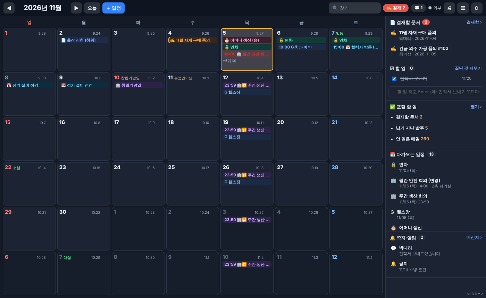

# 한일 바탕화면 달력 (`hanil-cal.exe`)

DesktopCal 처럼 **바탕화면 자체가 달력**이 되는 Windows 프로그램에 **회사 포털을 붙였습니다.**
결재 문서 · 회사 일정 · 쪽지가 달력에 나오고, 메모는 **다른 PC·폰과 동기화**되며, **개인 구글 캘린더**와도 주고받습니다.

**[⬇ hanil-cal-v1.4.1.exe](https://github.com/hanil-tech/hanil/raw/claude/magical-pascal-b2ksp0/release/hanil-cal-v1.4.1.exe)** (직원 PC, 설치 파일 하나)
· **[⬇ hanil-cal-portal.zip](https://github.com/hanil-tech/hanil/raw/claude/magical-pascal-b2ksp0/release/hanil-cal-portal.zip)** (포털 서버 — 회사 일정·자동 휴일·동기화·구글·폰 달력)



## 1.4.1
- **결재할 문서가 0 으로 나오던 것** — 포털은 내 차례 문서를 결재함 응답의 `waiting` 이 아닌 다른 칸에 준다.
  이제 끝난 것·내가 올린 것·참조 칸을 뺀 **모든 목록 칸**을 모아 문서마다 `my_turn` 으로 가린다.
  그래도 못 찾은 것이 있으면 **포털 첫 화면이 센 「결재할 문서」 수**를 따르고 「포털 결재함에 N건」 으로 이어 준다(그 수가 늘면 알림).
- **🔄 새로고침 단추**(머리줄) — 30초마다 저절로 하는 것과 별도로 바로. 달력 창으로 돌아올 때도 바로 새로고침.

## 1.4.0 — 📝 메모장
옆 칸의 **「📝 메모장」** — 날짜와 상관없는 간단한 메모(연락처·할 말·참고 글 …).
- 「＋ 새 메모」 → 큰 메모 창에 적는 대로 저장(저장 단추 없음). **첫 줄이 메모 이름.**
- 메모 색 · 📌 맨 위에 두기 · 복사 · 지우기(실수로 지워도 ⚙ 동기화·백업 → 지난 판에서 되살리기).
- 🔍 찾기에 함께 나오고, 다른 PC·폰(포털 `/deskcal`)과 동기화 · 백업 파일에도 들어갑니다.

## 1.3.0 에서 바뀐 것
- **결재할 문서 = 포털이 「내 차례」(my_turn)라고 한 것만.** 폰 앱이 승인 단추를 띄우는 그 값으로 문서마다 확인한다(앞사람 차례·참조 문서는 「결재 중」).
- **결재 문서를 열면 투명도 100%**(닫으면 원래대로 — 설정은 그대로).
- **🎨 색 바꾸기**: ⚙ → 화면 → 색 묶음(기본·어둡게·바다·숲·벚꽃·모래·밤바다) 또는 배경·날짜 칸·머리줄·글자·오늘 칸·일/토요일·강조색을 직접. 다른 PC·폰과 동기화.
- **🚀 시작프로그램**: ⚙ → 화면 → 「윈도우가 켜질 때 저절로 띄우기」 켜고 끄기.
- **⏻ 끄기** (1.3.1): 머리줄 맨 오른쪽 ⏻ 단추 · ⚙ 설정 창 아래 「달력 끄기」 (시계 옆 📅 아이콘 오른쪽 메뉴 「끄기」도 그대로).

## 🔄 자동 업데이트 (1.2.0~)
새 판을 다시 받아 깔 필요가 없습니다. 달력을 **켤 때마다 한 번**(30초 뒤) 저장소의 `release/hanil-cal.json` 을 보고,
새 판이면 뒤에서 받아 크기·SHA-256 을 맞춰 본 뒤 **화면이 한가할 때**(메모를 적거나 창을 열어 두지 않았을 때) 「새 판으로 바꿉니다」 를 5초 띄우고 바꿉니다.
메모·로그인·자리·투명도는 그대로. 「나중에」 를 누르면 한 시간 뒤 다시. 끄려면 `hanil-cal.ini` 에 `AUTOUPDATE=0`.
⚠ 1.1.0 이하에는 이 기능이 없어 **1.2.0 은 한 번만 직접** 받아 두 번 눌러 주세요. 그다음부터는 저절로입니다.

## 1.1.0 에서 바뀐 것
- **결재할 문서 = 정말 내 차례인 것만.** 포털 결재함의 `waiting` 에는 앞사람 차례·참조 문서도 들어 있었다 →
  포털 첫 화면이 세는 「결재할 문서」 수를 기준으로, 문서 결재선의 «지금 차례»가 나인 것만 고른다. 나머지는 「결재 중」 으로만 보이고 알리지 않는다.
- **포털에 원래 있는 달력**을 스스로 찾아(로그인한 뒤, 하루 한 번) 📅 로 보인다. ⚙ → 달력 → 「포털 달력」 에서 찾은 주소와 물어본 내역을 볼 수 있다.
- **포털 할 일**의 영문 이름(po_overdue·mailbox·recon …)을 우리말로. × 로 항목 숨기기(⚙ → 달력에서 되살리기).
- **크기 조절**: 바탕화면에 깔린 채로 가장자리·모서리를 끌기 · 머리줄 빈 곳을 끌어 옮기기 · ⚙ → 화면 → 작게/보통/크게/화면 가득 + 오른쪽/왼쪽/가운데.
- **투명도**: 머리줄에 🌫 막대 · 시계 옆 📅 아이콘 오른쪽 메뉴에 90~50%.
- 포털 조각의 폰 화면 주소를 `/calendar` → **`/deskcal`** (포털에 원래 있는 달력 화면과 겹치지 않게).
- 포털 자료의 칸 이름이 예상과 다를 때 맞출 수 있게 `hanil-cal.log` 에 «진단:» 줄(자료 모양)을 남긴다.

## DesktopCal 기능과 견주어

| DesktopCal | 이 달력 |
|---|---|
| 바탕화면 위에서 더블 클릭하면 바로 일정 등록 | ✅ 날짜 칸 **두 번 누르기** → 그 자리에 적기 (`📅 일정으로` 단추로 포털 일정으로 올리기도) |
| 만년 음력 · 절기 · 명절 · 기념일 정보 | ✅ 날마다 음력(윤달 포함, 연도 제한 없음) · **24절기** · 공휴일·대체공휴일 · 어버이날·스승의날·정월대보름·단오·칠석 … |
| 여러 기기 사이 데이터 이동 | ✅ **백업 파일 내보내기/가져오기** · 일정 엑셀(CSV) |
| 원하는 날짜·형식으로 인쇄 | ✅ 🖨 **시작 달 ~ 끝 달**, **달력 모양 / 목록**, 메모·일정·결재 고르기 (PDF 저장도) |
| 중요한 날 배경색 | ✅ 메모를 적을 때 **글자색 · 칸 배경색** |
| 쉬운 설정 | ✅ ⚙ 밝게/어둡게 · **투명도** · 글자 크기 · 주 시작 · 한 달/이번 주부터 N주 · 음력·절기·주차 표시 … |
| 클라우드 동기화 · 롤백 | ✅ 포털에 사람마다 저장 · **지난 판 30개에서 되돌리기** |
| 모바일 달력 실시간 동기화 | ✅ 폰 앱·브라우저에서 **포털 `/deskcal`** — 같은 화면, 30초마다 주고받음 |
| (그 밖) 반복 일정 · 알림 · 할 일 · 찾기 · 기념일 | ✅ 매주/매월/매년 반복 · **⏰ 미리 알림** · ☑ 할 일 목록 · 🔍 찾기 · 🎂 양력/음력 기념일 |
| — | ➕ **결재 문서 · 결재 차례 알림 · 회사 일정 · 쪽지 · 구글 캘린더** |

## 무엇이 보이나

| 무엇 | 어디에 | 어디서 오나 |
|---|---|---|
| ✍ **결재할 문서**(내 차례) | 기안일 칸(주황) · 옆 칸 맨 위 · 머리줄 빨간 숫자 | 포털 결재함 |
| 📄 내가 올린 문서 · 끝난 문서 | 기안일 칸 — 설정에서 고름 | 포털 결재함 |
| 🏢 **회사 일정** · 🔒 내 일정 (🔁 반복) | 날짜 칸 · 옆 칸 「다가오는 일정」 | 포털 |
| **G** 내 구글 캘린더 일정 | 날짜 칸(파랑) | 구글 (포털이 대신 읽음) |
| 🔴 공휴일 · 대체공휴일 · 회사 휴무일 | 날짜 숫자가 빨갛게 + 이름 | 포털이 공공데이터포털에서 자동으로 / 없으면 계산 |
| 음력 · 24절기 · 기념일 정보 | 칸 오른쪽 위(음력) · 초록(절기) · 갈색(기념일) | 계산 |
| 🎂 내 기념일(양력·음력) | 날짜 칸(분홍) | 내 자료(동기화) |
| 📝 메모(글자색·칸 배경색) · ☑ 할 일 | 날짜 칸 · 옆 칸 | 내 자료(동기화) |
| ✅ 포털 할 일 · 💬 쪽지 · 🔔 알림 | 옆 칸 | 포털 |

## 🔔 알림

- **결재 차례** — 새 문서가 오면(30초마다 확인) 달력이 **모든 창 위로** 올라와 가운데에 「📄 결재할 문서가 N건 있습니다」 카드(「나중에」·「결재하러 가기」를 누를 때까지) + 오른쪽 아래 윈도 알림(누르면 그 문서 결재 화면). 켤 때 남아 있으면 하루 한 번.
- **⏰ 일정 미리 알림** — 일정마다 5분·10분·30분·1시간·하루 전. 같은 카드 + 윈도 알림.
- **쪽지·알림** — 오른쪽 아래 윈도 알림.
- 설정(⚙ → 알림)에서 「알림만」·「끄기」로 바꿀 수 있습니다.

## 🌫 투명도

⚙ → 화면 → **투명도** 30~100% — 움직이는 대로 바탕화면이 비쳐 보입니다.
화면이 검게 나오는 PC(오래된 그래픽 드라이버)라면 시계 옆 📅 아이콘 오른쪽 누르기 → **「투명도 원래대로」**.

## ☁ 동기화 · 🟦 구글

- **포털 로그인 한 번**이면: 결재 문서 · 회사 일정 · 쪽지가 오고, 내 메모·할 일·기념일·설정이 포털에 저장되어
  **다른 PC 의 바탕화면 달력과 폰(포털 `/deskcal`)에서 똑같이** 보입니다. 바꾸면 바로 올라가고 30초마다 받아 옵니다.
- **되돌리기**: ⚙ → 동기화·백업 → 🕘 지난 판 보기 — 판마다 시각·기기·메모 수가 나오고 「되돌리기」(되돌린 것도 새 판으로 남음).
- **구글 → 달력**: ⚙ → 구글 → 구글 캘린더 「iCal 형식의 비공개 주소」를 붙여 넣기 → 내 구글 일정이 「G」로 보입니다(10분마다 새로).
- **달력 → 구글**: ⚙ → 구글 → 「주소 만들기」 → 구글 캘린더 「URL로 추가」 → 회사 일정·내 일정·기념일이 구글 캘린더·폰에 나옵니다.
  > 구글 OAuth 앱 등록 없이 되는 방식이라 구글 쪽 반영은 구글이 몇 시간마다 다시 읽을 때 됩니다.
  > 실시간 양방향(구글에서 고치면 바로 달력에 · 달력에서 고치면 바로 구글에)이 필요하면 회사 이름으로 Google Cloud OAuth 앱을 등록해야 합니다.

## 쓰는 법

- **＋ 일정** / 칸의 **＋** → 회사 일정(모두에게) · 내 일정(나만), 여러 날, 시각, 🔁 반복(끝나는 날), ⏰ 미리 알림, 🔴 회사 휴무일, 장소, 메모, 색.
- 일정을 누르면 고치기·지우기(올린 사람과 관리자만). 결재 문서를 누르면 **종이가 달력 안에** → **🌐 포털에서 결재하기**.
- 날짜 칸 **두 번 누르기** → 메모 + 글자색·칸 배경색 → 다른 곳 누르기/Ctrl+Enter 로 저장.
- ☑ 할 일: 옆 칸 아래에 적고 Enter (끝에 `11/20` 을 붙이면 그날까지 — 지나면 빨갛게).
- 🔍 찾기: 메모·할 일·기념일·일정(앞뒤 2년)·결재 문서. 결과를 누르면 그 달로.
- ◀ ▶ · 마우스 휠 · ← → 로 넘기기. ☰ 옆 칸 숨기기.

### 바탕화면에 깔기
- 처음 켜면 화면 오른쪽에 큼직하게 **바탕화면에 깔립니다** — 다른 창 뒤로 숨고, 작업 표시줄에는 안 나옵니다.
- **↔ 위치 조정** → 테두리가 생겨 옮기고 크기 바꾸기 → **📌 고정**.
- 시계 옆 **📅 아이콘**: 누르면 잠시 앞으로, 오른쪽 누르기 = 메뉴(위치 조정·새로 고침·포털 열기·투명도 원래대로·**끄기**).
- 바탕화면에 깔린 동안 Alt+F4 로는 안 꺼집니다(실수 방지). 윈도우가 켜질 때 저절로 뜹니다.

## 설치

### 직원 PC
`hanil-cal-v1.4.1.exe` 를 두 번 누르면 끝(관리자 권한 필요 없음). `%LOCALAPPDATA%\HanilCal\app\` 에 스스로 설치하고 아이콘·시작프로그램을 만듭니다.
처음 한 번 **「로그인」** 띠를 눌러 포털 로그인(2단계 인증 포함 그대로) — 「로그인 유지」를 켜 두세요.

> **파일이 안 열릴 때** — "Windows의 PC 보호" → **[추가 정보]** → **[실행]** (사내 프로그램이라 서명이 없어서).
> **창이 안 뜰 때** — 윈도우 10 일부에 없는 **WebView2 런타임**이 필요합니다(윈도우 11 에는 있음). 안내 창의 주소에서 받으세요.

### 포털 서버
`hanil-cal-portal.zip` 의 `설치안내.txt` 대로 `calendar-route.js` · `calendar-page.html` 을 `server.js` 옆에 두고 한 줄:
```js
require('./calendar-route')(app, { holidayKey: '공공데이터포털 인증키' });
```

| 포털 API | 하는 일 |
|---|---|
| `GET/POST /api/cal/events` · `PUT/DELETE /api/cal/events/:id` | 회사 일정·내 일정(반복·알림·휴무일) |
| `GET /api/cal/holidays?year=` | 그해 공휴일(data.go.kr) + 회사 휴무일 |
| `GET/PUT /api/cal/mydata` · `GET …/history` · `POST …/rollback` | 내 메모·할 일·기념일·설정 동기화 · 지난 판 · 되돌리기 |
| `GET/PUT /api/cal/gcal` | 내 구글 캘린더(비공개 iCal 주소) 읽기·연결 |
| `POST /api/cal/feed` · `GET /api/cal/feed/<열쇠>.ics` | 구글로 보낼 구독 주소(로그인 없이 — 주소가 열쇠) |
| `GET /deskcal` | 폰·브라우저용 달력 화면 (포털에 원래 있는 `/calendar` 와 겹치지 않게) |

## 어떻게 동작하나

```
 직원 PC                                              회사 서버                         바깥
┌───────────────────────────────────────┐        ┌──────────────────────────┐     ┌──────────────┐
│ hanil-cal.exe                         │        │ 한일 포털                 │     │ data.go.kr   │
│  ├ 관문 127.0.0.1:18850 ──────────────┼──────▶ │  결재함·할 일·쪽지        │────▶│ (공휴일)     │
│  │  · 달력이 쓰는 길만 통과            │        │  calendar-route.js       │     │ Google 캘린더│
│  │  · 결재 승인·반려 같은 쓰기는 막음   │        │   /api/cal/* · /deskcal  │◀───▶│ (iCal)       │
│  │  · 세션 쿠키 보관(DPAPI 암호화)      │        └────────────▲─────────────┘     └──────────────┘
│  └ WebView2 창 — 바탕화면 층 · 투명도  │                     │
│     └ 📅 알림 영역 아이콘 · 윈도 알림   │              폰 앱·브라우저 /deskcal
└───────────────────────────────────────┘
```

- 포털 주소: 사내 `http://192.168.1.30:8820` 먼저, 안 되면 `https://work.hanil-steel.com`.
- **비밀번호를 저장하지 않습니다.** 포털 로그인 화면을 그대로 쓰고, 세션 쿠키만 이 PC·이 윈도우 사용자만 풀 수 있게 암호화해 둡니다.

## 설정 파일 (`%LOCALAPPDATA%\HanilCal\app\hanil-cal.ini`)

```ini
URL=http://192.168.1.30:8820,https://work.hanil-steel.com
PIN=1               ; 1 = 바탕화면에 깔기 / 0 = 보통 창
AUTOSTART=1         ; 1 = 윈도우가 켜지면 저절로
SHORTCUT=1          ; 1 = 바탕화면·시작 메뉴 아이콘
PORT=18850          ; 이 PC 안의 관문 번호
```

## 이 PC 에 남는 것 (`%LOCALAPPDATA%\HanilCal\`)

| 파일 | 내용 |
|---|---|
| `data.json` | 메모·할 일·기념일·설정(포털과 동기화되는 것의 사본 — 포털이 꺼져도 보임) |
| `session.dat` | 포털 로그인 세션(암호화) — 지우면 다시 로그인 |
| `window.json` · `alpha.txt` | 달력 자리·크기 · 투명도 |
| `hanil-cal.log` | 기록 — 안 될 때 이 파일을 보내 주세요 |

## 만들기 · 점검 (개발자용)

```bash
./deskcal/build.sh          # → release/hanil-cal-v<판>.exe · release/hanil-cal-portal.zip
```

```bash
cd deskcal && go build -o /tmp/hanil-cal . && cd test && npm i && node check.js
```

점검(`test/check.js`, 56개)은 가짜 포털(`test/fake-portal.js` — 진짜 `calendar-route.js` 를 씀) + 관문(리눅스 빌드) + 화면(Playwright)으로
로그인 · 결재 차례 알림 · 문서 보기 · 일정 등록/고치기/권한/반복/미리 알림 · 메모·칸 색 · 할 일 · 기념일(음력) · 음력·절기·휴일(자동·계산·대체·회사 휴무) ·
구글(읽기·구독 주소) · 투명도 · 찾기 · 인쇄 · N주 보기 · **PC↔폰 동기화 · 되돌리기** · 세션 유지 · 막힌 길을 확인합니다.
⚠ 바탕화면 층에 깔기·알림 영역 아이콘·윈도 알림·투명도(Win32)는 리눅스에서 시험할 수 없어 **윈도우 PC 에서 직접 확인**해야 합니다.
