# 한일 판금 전개

**제작사 : 한일특장(주)** · https://www.hanil-steel.com · Copyright © 2025–2026 한일특장(주). All rights reserved.

3D 도면(STEP)을 열면 **펼친 모양(전개도)** 을 계산해 **레이저 가공용 DXF** 와 **보고서(PDF·엑셀)** 로 저장하는 Windows 프로그램입니다.
판금 부품은 정확히 펼치고, **자동차 부품처럼 곡면이 있는 성형품**은 블랭크를 근사로 펼칩니다.

- 두께는 자동으로 잽니다.
- **재질별 · 상형 R 별 연신**을 문헌 공식과 표로 계산하고, 회사에서 잰 연신값이 있으면 그것을 먼저 씁니다.
- **직각이 아닌 형상**도 펼칩니다: 30°·45°·120° 같은 절곡, 비스듬한 절곡선, 헤밍, 원뿔(깔때기)·원통 말기.
- 절곡 목록(번호, 위/아래 방향, 각도, 모델 R·실제 R, K, 연신, 근거)을 보여 주고 DXF 에도 적습니다.
- **성형품(자유곡면) 근사 전개** — 블랭크 모양·크기·무게와 두께 변화 색 지도.
- **보고서 PDF·엑셀** — 전개도(치수), 3D 그림, 블랭크 넓이·무게·수율·절단 길이, 절곡 표.
- 여러 파일을 한꺼번에 DXF·보고서로 바꾸고, **부품 목록 엑셀**(견적·발주용)도 만듭니다.

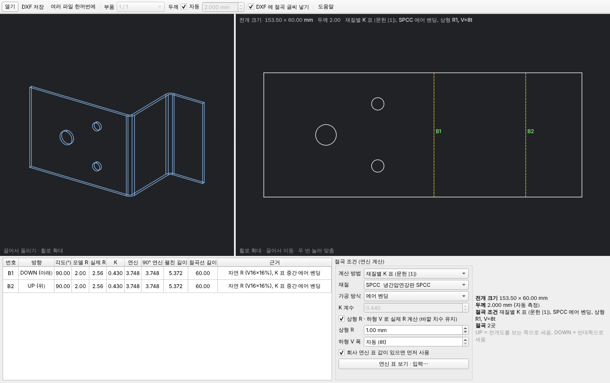

## 어떤 파일을 열 수 있나

| 파일 | 열 수 있나 | 방법 |
|---|---|---|
| STEP (`.stp`, `.step`) | **바로 열림** | — |
| IGES (`.igs`, `.iges`) | 바로 열림 | — |
| 솔리드웍스 (`.sldprt`) | STEP 으로 저장 후 | 파일 → 다른 이름으로 저장 → **STEP AP214** |
| NX (`.prt`) | STEP 으로 저장 후 | 파일 → 내보내기 → **STEP** |
| CATIA (`.CATPart`) | STEP 으로 저장 후 | File → Save As → **stp** |
| AutoCAD 3D (`.dwg`) | STEP 으로 저장 후 | 3D 솔리드를 STEP 으로 내보내기 |

> **다른 CAD 에서 변환한 STEP** (예: HOOPS Exchange 로 만든 파일)은 평면과 절곡 R 까지 모두 자유곡면(B-스플라인)으로
> 저장된 경우가 많습니다. 열 때 면마다 실제 모양(평면·원통·원뿔)을 알아내 되돌리므로, 판금 부품은 그대로 정확 전개되고
> 절곡 표도 나옵니다. 정말 곡면인 부분(성형 모서리 등)이 남으면 성형품 근사 전개로 갑니다.
> 여러 부품이 든 조립품 파일은 [부품] 에서 하나씩 고르거나, [여러 파일 한꺼번에] 로 모두 처리합니다.
> 굽힌 파이프처럼 둘레가 닫힌 부품은 펼치는 대상이 아니라고 알려 줍니다.

솔리드웍스·NX·CATIA·DWG 파일은 각 회사 고유 형식이라, 무료로 쓸 수 있는 3D 엔진(OpenCASCADE)으로는
직접 읽을 수 없습니다. 이런 파일을 열면 프로그램이 **어디서 어떻게 STEP 으로 저장하는지** 안내합니다.
STEP 은 세 CAD 모두 기본으로 지원하고, 판금 형상이 그대로 담깁니다.

> 고유 형식을 바로 열려면 CAD Exchanger, HOOPS Exchange 같은 **유료 변환 라이브러리**를 사야 합니다.
> 필요하시면 붙일 수 있는 구조로 만들어 두었습니다 (`hanil_unfold/loader.py`).

## 부품 한 번에 분석 (1.28.0)

[파일]·[금형]·[견적] 탭의 **[부품 한 번에 분석]** (Ctrl+Shift+P): 도면(조립품)에서 **부품 하나**를 고르고
연간 생산량·고객 (아이템 대장과 이을 수도) 을 넣고 **[한 번에 분석]** — 부품 하나에 필요한 것을 모두 한 폴더
(`부품이름_부품분석_날짜시각`) 에 만듭니다 (10 초 안팎):

| 파일 | 내용 |
|---|---|
| 00_요약.pdf | 한 쪽 요약: 전개도 · 3D (성형품은 성형성 존) · 전개 크기·블랭크·성형 판정·금형 형식·공정·톤수·금형비 (강판/주물)·판매 단가·설비 부하·양산 일정·PFMEA |
| 01_전개도.dxf · 01_전개보고서.pdf/.xlsx | 레이저용 전개도, 전개 보고서 |
| 02_성형해석.pdf/.xlsx | 성형성 존·두께·FLD / 절곡 균열·스프링백, 하중 |
| 03_금형검토.pdf/.xlsx | 하중·클리어런스·설계 규칙·스트립·드로잉·자동 공정 설계 |
| 04_금형공정도.pdf (.dxf) | 순차 금형 스트립 / 드로잉 공정도 |
| 05_생산견적서 · 05_금형견적서 | 견적서, 금형 견적서 (간략도, 큰 금형은 주물) |
| 06_원가계산서 | 협력사 양식, 수량별 단가표 |
| 07_생산계획 | 설비 부하·인원·소재·금형 → 양산 일정 |
| 08_품질문서 | 공정 흐름도·PFMEA·관리계획서 |

끝나면 요약이 열리고, 창에 요약 표와 파일 링크가 나옵니다. [견적·금형 기록] 에 "부품 분석" 으로 남고,
아이템을 골랐으면 그 아이템에 견적 리비전이 쌓입니다. 조립품 전체는 아래 [전체 분석] 을 쓰세요.

## 전체 분석 (한 번에)

**[파일] 또는 [견적] → [전체 분석]** (Ctrl+Shift+A): 견적 창이 열리면 견적 수량·연간 생산량·수신을 넣고
**[전체 분석 (한 번에)…]** → 폴더를 고르면 `제품_분석_날짜_시각` 폴더에 한 번에 만듭니다.

```
3D 조립품 → 부품 분리(같은 부품 묶음·분류) → 전개 → 자재비 → 부품별 공정도 → 생산 견적 → 금형 견적
```

| 파일 | 내용 |
|---|---|
| 01_제품_BOM.xlsx | 다단계 BOM (완제품 → 반제품 → 부품 → 원자재), 부품 합계, 원자재 소요량, 구매·표준품 |
| 02_제품_자재비.xlsx | 요약 · 부품별 자재비 (소요·제품·스크랩 kg, 단가, 세트·견적 수량 금액) · 재질별 소요량 · 부자재 |
| 03_제품_공정도.pdf | 차례 (부품별 방식·공정수·톤수·기계·쪽) + 부품마다 순차 금형 스트립 공정도 · 자동 공정 설계 / 레이저·절곡 작업표 |
| 04_제품_생산견적서.xlsx · pdf | 생산 견적서 |
| 05_제품_금형견적서.xlsx · pdf | 금형 견적서 (금형이 필요한 부품이 있을 때) |

예: 붐 조립품 STEP (67 부품, 자작 21 종) → 7 개 파일, 약 25 초. 기록 창에 "전체 분석" 으로 남습니다.

## 유럽 · 일본 문헌 반영 (1.29.0)

| 분야 | 반영한 것 | 출처 |
|---|---|---|
| 해석 · 드로잉 | **한계 드로잉비 LDR = exp(η·√((1+r)/2))** (η 0.74): 재질 r 로 첫 드로잉률을 고침 (SPCC r 1.3 → ×0.95 더 깊게, AL5052 r 0.7 → ×1.06), 성형 해석에 β > LDR 이면 다단 드로잉 경고 | Whiteley (1960), Hosford·Caddell 「Metal Forming」 |
| 해석 · 드로잉력 | **Siebel 식** π·d·s·1.1·k_fm·ln(D/d) ÷ η_F (0.65, k_fm = 홀로몬 평균 유동 응력) 을 교재 식 (π·d·t·σb·n) 과 같이 계산해 **큰 값**으로 프레스를 고름 | Siebel · Panknin (독일 Umformtechnik 교재) |
| 금형 설계 | **VDI 3368 클리어런스** u = c·s·√(0.1·τ) (c 0.01) 를 금형 검토에 같이 표시, **다이 두께 어림** H ≈ ∛(0.1·F) | VDI 3368, Hanser 「Formelsammlung Fertigungstechnik」 |
| 전개 · 품질 | **보통 공차 JIS B 0408** (打抜き·曲げ絞り A·B·C 급) 과 **ISO 2768-1** (f·m·c·v) 표 — 관리계획서 규격, 보고서·DXF 노트 (공차 없는 치수 = JIS B 0408-B / ISO 2768-m) | JIS B 0408:1991, ISO 2768-1 |
| 원가 | **기계 임률 계산기**: (감가상각 + 계산상 이자 (투자액 절반) + 공간 + 전력 + 보수) ÷ 가동 시간 + 노무비 — [기계·임률] 탭 [임률 계산] | 독일 Maschinenstundensatz (VDI 3258 의 틀), 일본 チャージ (加工費レート) |

JIS B 0408 보통 공차 (±mm, B 급):

| 치수 | ~6 | 6~30 | 30~120 | 120~400 | 400~1000 | 1000~2000 |
|---|---|---|---|---|---|---|
| 打抜き (펀칭·블랭킹) | 0.1 | 0.2 | 0.3 | 0.5 | 0.8 | 1.2 |
| 曲げ・絞り (굽힘·드로잉) | 0.3 | 0.5 | 0.8 | 1.2 | 2 | 3 |

## 차체 (BIW) 프레스 부품 성형 해석 (1.43.0, 전체판)

카울·에이프런·사이드 멤버·대시·플로어 같은 차체 부품을 위한 손질입니다.

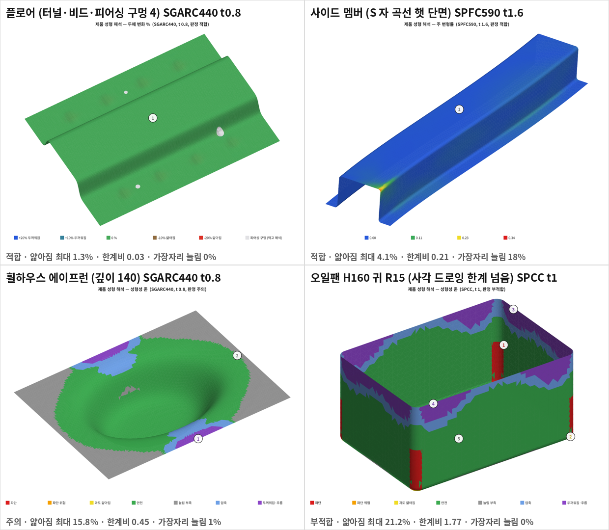

- **고른 면 메시**: CAD 메시기는 길게 곧은 면에 면 길이만큼 긴 바늘 삼각형 부채꼴을 만들어, 절곡 R 을 가로지르면 변형률이
  점점이 튀었습니다 (사이드 멤버 끝 가장자리 늘림 104 % → 부적합). 이제 면마다 실제 길이로 고른 격자 (굽은 곳은 한 칸 0.15 rad,
  자유곡면의 작은 R 도 15 × 15 점에서 찾음) 를 깔고 경계는 이웃 면과 같은 점을 씁니다 → 18 %, 판정 적합.
- **피어싱 구멍**: 평평한 판에 뚫린 구멍은 대부분 드로잉 뒤 피어싱이라, 막고 해석합니다 (블랭크에도 없음, 그림에 옅은 회색,
  판정·통계에서 뺌). 둘레가 벽인 세운 구멍 (버링) 은 그대로 둡니다.
- **잘린 끝 단면**: 원스텝의 가장자리 금형 저항 (누르개 마찰·다이 R) 을 다이 면을 따라 눕는 경계에만 겁니다 (햇 단면 끝처럼
  벽을 따라 내려가는 경계는 끌려 들어오지 않음).
- **사각 드로잉 귀**: 원스텝은 깊은 귀의 터짐을 작게 봅니다 (H/R 10 의 오일 팬도 한계 비 0.8). 귀 벽 아래 (펀치 R 위) 의 한계 비를
  경험식 이용률 (깊이 / 귀 R) ÷ 6 (MetalForming) 아래로 내리지 않아, 판정과 3D 그림·성형 과정이 같은 말을 합니다.
- **재질**: SPFC440 (JSC440W 급) · SPFC780 (DP780 급) · SPFC1180 (DP·CP 1180 급). 구멍 확장률은 DP780 펀칭 약 14 % ·
  밀링 38 % (MIT 시험) 에서 펀칭 쪽 0.2, 1180 급은 공개값이 없어 판정하지 않습니다. 실제 값은 밀시트·소재 업체 FLC 를 넣으세요.
- 한계: 바인더·어덴덤 (다이 페이스) 과 공정별 (드로잉 → 트림 → 플랜지) 해석은 아직 없습니다 — 제품 모양 하나로 보는 원스텝입니다.

## 성형 해석 정확도 · 3차 곡선 전개 · 인식률 (1.42.0)

**성형 해석 (전체판)** — 원스텝 (막) 역해석이 못 보는 것을 더합니다 ([성형 해석] 메시지 "드로잉 보정 …").

- **인장 아래 굽힘** (Marciniak·Duncan·Hu, *Mechanics of Sheet Metal Forming*): 장력 T 가 걸린 채 반지름 ρ 를 감거나
  펴지면 중립면이 안쪽으로 (T/Ty)·t/2 옮겨 가 가운데 면이 늘어납니다 — 굽힘 한 번에 Δε = (T/Ty)·t/(2ρ).
  펀치 R 처럼 감긴 곳은 1 번 (주 변형률 방향의 곡률, CAD 곡면 법선으로), 다이 R 을 지나 벽이 된 재료는 굽힘 + 펴짐 2 번
  (다이 R = Oehler·Kaiser 식).
- **드로잉 장력**: 행정마다 남은 플랜지로 Siebel 장력 t·1.1·k_f·ln(R/r)/η_F 를 구해, 재료가 다이를 지난 뒤 겪는 가장 큰 장력을
  그 자리의 항복 장력 (Hill 평면 변형, Swift 경화) 과 견줍니다. 넘으면 장력 평형까지 더 늘리고, 벽 강도 (평면 변형 최대 하중,
  ε1 = n − hp·ε0) 를 넘으면 터짐. 이 장력 / 벽 강도는 재질 15 종에서 β = LDR (Whiteley·Hosford) 때 0.88~1.0 — 두 식이 같은 곳에서
  터진다고 합니다 (SUS304 만 0.72).
- **아이어닝**: 다이 틈새 (판 두께 1.1 배, MISUMI) 보다 두꺼워지려는 벽은 틈새 두께로.
- 결과 (Ø100 · 깊이 50 · 바닥 R 8 · t1 SPCC 컵, β 1.71): 가장 얇은 곳이 펀치 R ~ 벽 아래 **14 %** (보정 전 원스텝 4~5 %).
  연강 컵 시험값 0.7 mm 15.6 %, 2 mm 18 % (펀치 R 부근) 와 같은 범위입니다. 위 끝은 +10 % (틈새로 훑임).
- 원스텝 계산 바로잡기: 블랭크가 통째로 90° 돌면 가장자리 금형 저항 (누르개 마찰·다이 R) 이 0 이 되던 허점을 고쳤습니다
  (오래·촘촘히 돌리면 금형 작용 없는 해로 빠졌음). 고친 뒤 메시 6 천 → 2 만 삼각형에서 블랭크 넓이 0.03 %, 두께 1 %p 안에서 같음.

**어려운 형상으로 돌려 본 결과 (1.42.1)** — 후드·휀다·오일팬·깊은 컵 (β 1.71 / 2.11 / 2.4)·버링·3차 곡선 플랜지·S 물결 단면·스플라인 윤곽.
β 2.4 컵 (LDR 2.21 넘음) 은 펀치 R ~ 벽 아래가 빨갛게 (터짐) 나와 한 번 드로잉으로는 안 된다고 판정합니다.

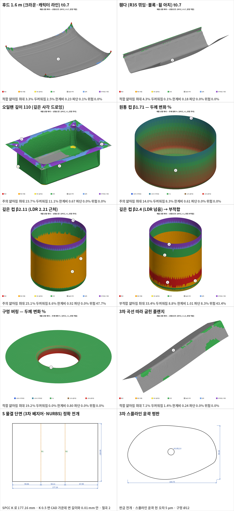

**3차 곡선 (베지어·B-스플라인) 이 있는 도면 전개**

- **곡선 단면 판** (단면이 3차 곡선인 S 자·물결·아치 판, 곡선을 민 면 = 일반 원통): 성형품 근사 대신 **판금으로 정확 전개**합니다.
  단면을 801 점으로 나눠 점마다 곡률 반지름과 볼록·오목을 구하고, 그 R/t 의 K 로 중립면까지 옮긴 선의 길이를 적분
  (원통 절곡 BA = θ(R + K t) 를 R 이 바뀌는 곡선으로 넓힌 것). 같은 쪽으로 휜 구간마다 절곡 하나 (S 자는 둘, 절곡 표에 "곡선 단면",
  R 범위). 모든 면이 B-스플라인인 변환 STEP 도 같고, 원통 절곡을 B-스플라인으로 바꾼 것도 원통 계산과 0.02 mm 안에서 같습니다.
- 스플라인 윤곽 (평판·플랜지의 자유곡선 외곽): 현 오차 **5 µm** 안이 되도록 잘게 나눠 전개도에.
- 2D DXF 의 SPLINE 은 전과 같이 0.01 mm 로 읽습니다.

**3D 도면 인식률**

- **곡면 (판 한 겹) 만 저장한 판금 파일** (두께 없는 서피스 STEP·IGES): 예전에는 "솔리드가 없습니다" 로 못 열었으나, 이제
  판 두께를 물어 곡면을 가운데 면으로 보고 양쪽 t/2 씩 두껍게 만들어 엽니다.
- 자유곡면 되돌리기: 10 µm 로 못 알아본 면은 50 µm 로 한 번 더, 다시 만든 솔리드가 깨지면 문제 면만 원래대로 두고 나머지는
  살립니다 (예전에는 한 면 때문에 부품 전체를 자유곡면으로 두었음). 원통·평면으로 못 되돌려도 곡선 단면 전개가 정확히 받습니다.

## 2D 도면 (DXF · DWG) 열기 (1.36.0)

[열기] 에서 **DXF·DWG** 를 고르면 도면의 블랭크 윤곽과 구멍을 찾아 판 두께만큼 평판으로 만듭니다.
그 뒤는 STEP 부품과 같아서 전개도·무게·절단 길이·네스팅·레이저/블랭킹 견적·금형 검토·검사 성적서를 바로 씁니다.

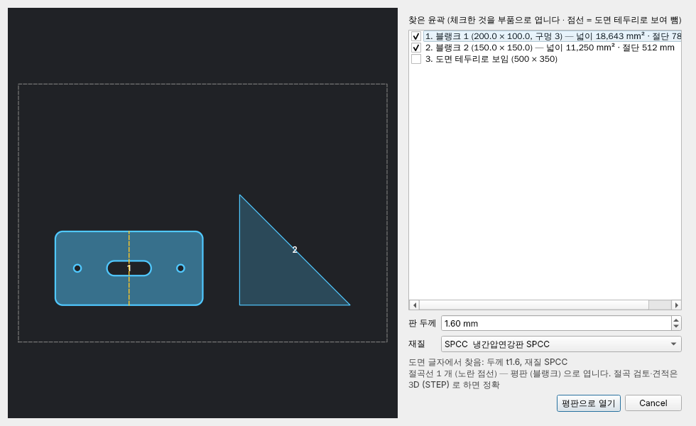

- 가져오기 창: 찾은 윤곽 미리 보기, 부품으로 열 것 고르기, 판 두께·재질 (도면 글자 `t1.6`·`2.0T`·`SPCC`·`SS400` 등에서 자동).
- 읽는 것: 선·원호·원·폴리선 (볼록 bulge)·스플라인·타원, 블록 (INSERT) 은 펼침. 빼는 것: 치수·글자·해치, 중심선·숨은선
  (선 종류·층 이름 DIM·CENTER·HIDDEN·치수·중심…). 다른 윤곽을 둘러싼 사각형은 **도면 테두리** 로 보고 뺍니다.
  절곡선 층 (BEND·절곡) 은 노란 점선으로 보여 주고 셉니다 — 절곡 해석은 3D (STEP) 로 하는 것이 정확합니다.
- 단위: DXF 헤더 `$INSUNITS` (inch·cm·m 를 mm 로). 끝점이 0.02 mm 넘게 떨어진 열린 선은 빼고 알립니다.
- **DWG**: AutoCAD 고유 형식이라 무료 **ODA File Converter** (Open Design Alliance) 로 DXF 로 바꿔 읽습니다 — 기본 설치 폴더
  (`C:\Program Files\ODA\ODAFileConverter …`) 는 자동으로 찾고, 다른 곳이면 [설정·도움말] → [DWG 변환기 위치].
  LibreDWG 의 `dwg2dxf` 가 있으면 그것도 씁니다. 변환기가 없으면 내려받을 곳을 알려 줍니다.
- 3D 솔리드가 든 DWG (ACIS) 는 읽지 못합니다 — AutoCAD 에서 STEP 으로 내보내세요 (STEPOUT).

## 성형 과정 3D — 어디서부터 터지고 주름지나 (1.40.0, 전체판)

[성형 해석] → **[성형 과정 (3D)]**: 블랭크 (평판) 가 펀치 깊이에 따라 제품이 되는 모습을 3D 로 보여 줍니다
(행정 막대·▶ 재생·끌어서 돌리기·움직이는 그림 GIF 저장).

**재생 조작 (1.41.0)**: ⏮ 처음 · ◀ 한 단계 (5 %) · **▶ 재생 / ❚❚ 멈춤** · ▶| 한 단계 · ⏭ 끝 · **🔄 회전** (재생과 같이 켜면
성형되면서 빙글 돕니다) · 속도 ×0.5/×1/×2 · 반복 · **⚠ 터지는 곳으로** (처음 터지는 행정으로 바로). 키보드: 스페이스 = 재생/멈춤,
← → = 한 단계. 왼쪽 제품 3D 화면에도 🔄 회전이 있습니다. 재생·회전 중에는 삼각형을 줄인 메시로 빠르게 그리고, 멈추면 원래 메시로 다시 그립니다.

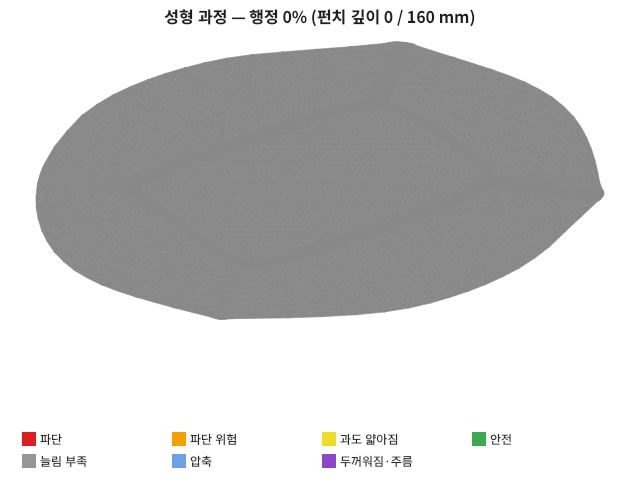

- 행정마다 성형성 존 색이 바뀌고, **가장 먼저 FLC 에 닿는 곳 (터지기 시작, 빨강)** 과 **가장 먼저 5 % 넘게 두꺼워지는 곳
  (주름 시작, 보라)** 을 그 행정부터 그림에 표시합니다.
- 아래 글: "터지기 시작: 행정 54 % (펀치 깊이 86 / 160 mm) — 귀 (모서리) 벽 (X 153, Y 107, Z 8)" 처럼 언제·어디서.
  파단 위험 (한계 80 %) 시작도 함께. 설명 탭의 판정 이유, 엑셀 [성형 과정] 시트, PDF (행정 25·50·75·100 %) 에도 들어갑니다.
- 그리는 방법: 원스텝 해석은 처음 (블랭크) 과 끝 (제품) 만 알므로, 가운데는 **비례 변형** (행정 s 에서 변형 = s × 끝 변형,
  원스텝 역해석의 가정) 과 **펀치 깊이** (블랭크를 누르개 높이에 놓고 펀치가 s × 깊이만큼 내려간 모양) 로 이어 그립니다.
  실제 금형 접촉 순서·다단 공정을 계산한 것은 아닙니다.

## 성형 해석 업그레이드 (1.39.0, 전체판)

[성형 해석] 창에 탭 네 개가 늘었습니다.

| 탭 | 하는 일 |
|---|---|
| **단면 (두께 그래프)** | 모델 X·Y·Z 평면 위치를 막대로 옮기며 그 단면을 따라 두께 변화 % 그래프 (가장 얇은 곳 빨간 표시, 기준선 −25 %·+5 %). 시험품을 같은 자리에서 잘라 잰 두께와 견주기, 엑셀로 내보내기 |
| **하중 - 행정** | 펀치 깊이마다 드로잉력 (Siebel + 홀더 마찰) · 누르개 (쿠션) 힘 · 합, 크랭크 프레스 능력 곡선 (F = P·sin30°/sin α) 과 견줘 **모든 깊이에서 되고 행정 ≥ 2 × 깊이인 가장 작은 프레스** |
| **FLC 입력 (실측)** | 소재 업체의 ISO 12004-2 성형 한계 시험 (ε2, ε1) 점을 붙여 넣으면 그 재질은 Keeler 식 대신 실측 곡선으로 판정 (진변형률·공칭·% 단위) |
| **재질·두께 비교** | 체크한 재질·두께로 같은 제품을 다시 펼쳐 판정·파단·얇아짐·한계 비·드로잉비·프레스를 한 표로, 추천 |

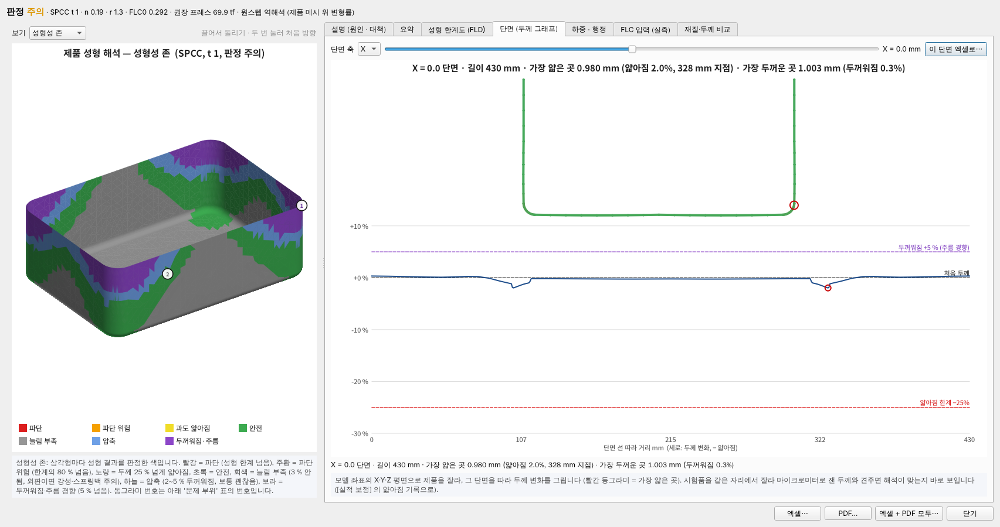

- 하중-행정은 같은 둘레의 원통 컵으로 본 어림입니다 (플랜지 지름 D(h) = √(D0² − 4dh)). 곡선의 최대 드로잉력은 해석의 드로잉력에 맞춥니다.
- 엑셀 보고서에 [단면 두께] (가운데 X·Y 단면) · [하중-행정] 시트, PDF 에 단면·하중 쪽이 들어갑니다.

## 두 가지 판 (1.38.0)

같은 소스에서 설치 파일 두 개를 만듭니다 (GitHub Actions 결과의 Artifacts 두 개).

| 판 | 설치 파일 · 실행 파일 | 들어 있는 것 |
|---|---|---|
| **전체판** | `HanilUnfold-Setup-<버전>.exe` · HanilUnfold.exe | 지금 프로그램 전부 — 전개 + 성형 해석 · 금형 · 견적 · 원가 · 생산 · 품질 · 검사 · 네스팅 · BOM · 실적 보정 |
| **전개 전용판** | `HanilUnfoldLite-Setup-<버전>.exe` · HanilUnfoldLite.exe | 3D (STEP·IGES)·2D (DXF·DWG) 도면 열기, 판금·성형품 전개, 전개도 DXF, 전개 보고서 PDF·엑셀, 조립도 PDF, 여러 파일 한꺼번에, ZIP, 전개 기록, 연신 표·시험 절곡·밀시트 (전개 정확도) |

- 두 판은 따로 설치되어 한 PC 에 함께 둘 수 있고, 절곡 조건·회사 연신 표·전개 기록은 같이 씁니다.
- 전개 전용판은 빌드할 때 판을 실행 파일 안에 못 박습니다 (`packaging/write_build_info.py --edition unfold` →
  `hanil_unfold/_edition.py`) — 설정을 바꿔도 다른 기능이 켜지지 않습니다. 명령줄 `nest`·`bom`·`ai-bom` 도 막힙니다.
- 직접 만들 때: `python packaging/write_build_info.py 0 "" --edition unfold`, `pyinstaller packaging/HanilUnfold.spec`,
  `iscc /DMyVersion=1.38.0 /DLite packaging\setup.iss`. 개발 중 확인은 `HANIL_EDITION=unfold`.

## 판금 전개 정확도 (1.37.0)

펼치는 기하 계산은 손 계산·다른 CAD 와 소수 넷째 자리까지 같습니다 ([docs/oracle.md](docs/oracle.md)).
남는 오차는 **굽힐 때 판이 늘어나는 양 (K·연신)** 이라, 이것을 맞추는 길을 넓혔습니다.

1. **가장 정확: 시험 절곡** — [절곡 조건] → [연신 표 보기 · 입력] → **[시험 절곡으로 재기]**: 길이 L 로 자른 띠를 실제 금형으로
   접고 바깥 치수 a, b 를 재면 연신 = a + b − L, K = (BA/θ − R)/t 를 계산해 연신 표에 넣습니다.
2. **회사 연신 표 보간** — 같은 재질 측정값이 있으면 잰 두께·R 이 아니어도 R/t 로 이어 써서 측정값을 따라갑니다
   (정보 칸 출처에 '회사 연신 표 보간 (n 점)').
3. **재질별 K 를 계단 없이** — 표의 구간 값 (Machinery's Handbook 계열) 을 R/t 0.7 · √3 · 5 에 두고 log(R/t) 로 이어 붙였습니다.
   예전에는 R/t 1·3 을 넘는 순간 K 가 뛰어 90° 한 번에 0.1 t 넘게 길이가 달라졌습니다.
4. **정확도 알림 (파란 ⓘ)** — K 를 직접 넣었는데 그 R/t 의 재질 K 와 다르면 절곡 하나에 몇 mm 차이인지,
   에어 벤딩인데 V 폭으로 정해지는 실제 R 이 모델 R 보다 크면 펼친 길이가 얼마나 달라지는지 알려 줍니다.

## SolidCraft 로 그린 부품 쓰기 (1.36.1)

3D CAD 가 없는 PC 에서는 무료 오픈소스 CAD [SolidCraft](https://github.com/tangency-labs/solidcraft) (Windows 설치판·브라우저판)
로 판금 부품을 그려 **STEP 으로 내보낸 뒤** 이 프로그램에서 열면 됩니다 (File → Export → STEP).
SolidCraft 로 만든 판금 STEP 6 종 (L 45°·90°·135°, U 채널, 트레이, t 1~3, K 0.33~0.5) 을 열어 전개한 크기가
SolidCraft 자신의 전개와 소수 넷째 자리까지 같음을 시험으로 확인했습니다 (`tests/data/solidcraft`, `tests/test_solidcraft_step.py`).
SolidCraft 의 K 계수는 판금 규칙 하나의 고정값이라, 이 프로그램에서는 재질·R/t·회사 연신표로 다시 계산하는 것이 더 정확합니다.

## 정답 대조 시험 (1.36.0)

SolidCraft 의 reference tests 처럼, 손으로 계산한 정답 (해석식) 과 문헌 계산 예제를 프로그램 결과와 견주는 **42 사례** 를 둡니다
— 판금 전개 (K 직접 12 · DIN 6935 5), 관·원뿔 말기, DXF 블랭크 넓이·절단 길이, 성형 컵·플랜지 컵 블랭크, 금형 설계 문헌 예제·블랭킹력,
무게, Keeler FLC0, Cpk, 보통 공차, 기계 임률, SolidCraft 교차 확인 6.
결과표는 [docs/oracle.md](docs/oracle.md) (`python tools/oracle_report.py` 로 다시 만듦), CI 에서 `tests/test_oracle.py` 가 확인합니다.

## 실적 보정 (1.35.0)

문헌 식과 재질값으로 맞출 수 있는 데에는 한계가 있습니다 (원스텝 해석은 R 부 얇아짐을 작게 보고, 사이클 타임·금형비는 회사마다 다름).
[기록] → **[실적 보정]** 에 현장에서 잰 값을 쌓으면 예측과 견줘 보정 계수를 구하고 다음 계산부터 곱합니다.

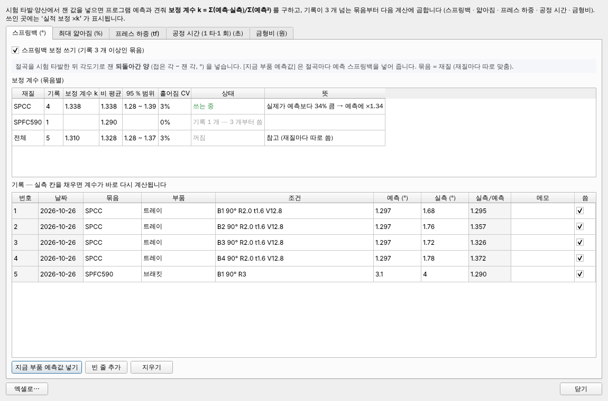

| 종류 | 예측 → 실측 | 묶음 | 곱하는 곳 |
|---|---|---|---|
| 스프링백 (°) | 되돌아간 양 | 재질 | 스프링백·금형 보정 각 (금형 검토·성형 해석) |
| 최대 얇아짐 (%) | 단면·초음파 두께 | 재질 | 성형 해석 두께·성형성 존 (얇아지는 쪽만) |
| 프레스 하중 (tf) | 하중 모니터 | 드로잉 / 성형 / 전단·굽힘 | 권장 프레스, 견적 프레스 고르기 |
| 공정 시간 (초) | 실제 1 타·1 회 | 기계 이름 | 견적 가공비 |
| 금형비 (원) | 금형 업체 청구 | 강판·주물 × 순차·단발 … | 금형 견적 ('실적 보정' 줄) |

- 보정 계수 k = Σ(예측·실측) / Σ(예측²) (원점을 지나는 최소 제곱 — 큰 건에 무게), **기록 3 개 이상** 인 묶음부터 씁니다.
  비 (실측/예측) 의 95 % 범위 (t 분포) 와 흩어짐 CV 를 같이 보여 줍니다 — CV 가 25 % 넘으면 조건이 다른 기록이 섞인 것이니 묶음을 나누세요.
  k 가 0.3~3 밖이면 입력 실수로 보고 쓰지 않습니다.
- 스프링백·얇아짐은 재질마다 따로 (다른 재질 계수를 빌리지 않음), 하중·시간·금형비는 묶음 기록이 모자라면 전체 계수를 씁니다.
- [지금 부품 예측값 넣기] 로 절곡별 스프링백·성형 문제 부위 얇아짐·하중 예측을 넣고 실측 칸만 채우면 됩니다.
  검사 성적서에서 성형 부위 두께를 저장하면 그 값을 얇아짐 기록으로 넣을지 묻습니다.
- 쓰인 곳마다 '실적 보정 ×k' 가 표시되고, 종류마다 끌 수 있습니다. 기록은 history.sqlite (PC 안 파일).

## 정확도 — 밀시트 실측값과 문헌 식 (1.34.0)

해석·설계 값은 **재질값이 가장 크게 좌우** 합니다. [절곡 조건] → **[밀시트 실측값]** 에 소재 검사 증명서의 항복·인장 강도, n, r 값
(0°·45°·90°), 탄성 계수를 넣으면 대표값 대신 성형 해석 (FLC0 = Keeler 식의 n), 스프링백, 굽힘·드로잉·누르개 하중, 드로잉 설계에 씁니다.

| 계산 | 식 (문헌) | 확인 |
|---|---|---|
| 누르개 면압 | p = [(β−1)^k + d/(200 s)]·Rm/400 (Siebel, k = 2·3 중 큰 값) | 문헌 예제 1.16 MPa 와 같음 |
| 다이 어깨 R | r_M = 0.035·[50 + (D − d)]·√s (Oehler·Kaiser), 5~10 t 검사 | 문헌 예제 5.25 mm 와 같음 |
| 드로잉 틈새 | 권장 1.0~1.1 t (MISUMI), 최대 t·β^(1/(1+r)) | 문헌 예제 1.41 mm 와 같음 (r = 1) |
| 굽힘력 | F = (1 + 4t/V)·σb·L·t²/V | 문헌 계수 |
| 스프링백 | 모멘트 법: 탄성 코어 + Swift 가공 경화 (YS·TS·n 맞춤) + Hill 평면 변형 (r), 고장력강 탄성 계수 감소 (Yoshida·Uemori) | 이론 (Marciniak·Duncan·Hu) |

식마다 근거와 확인 못 한 것은 [docs/문헌_검토.md](docs/문헌_검토.md) 의 1.34.0 절에 있습니다.

## 검사 성적서 (1.33.0)

[품질] → [검사 성적서] (Ctrl+Shift+I). 지금 부품의 도면 (전개 결과·3D·성형 해석) 에서 검사 항목과 공차를 뽑고,
측정값을 넣으면 합격·불합격과 공정 능력 (Cp·Cpk) 을 냅니다.

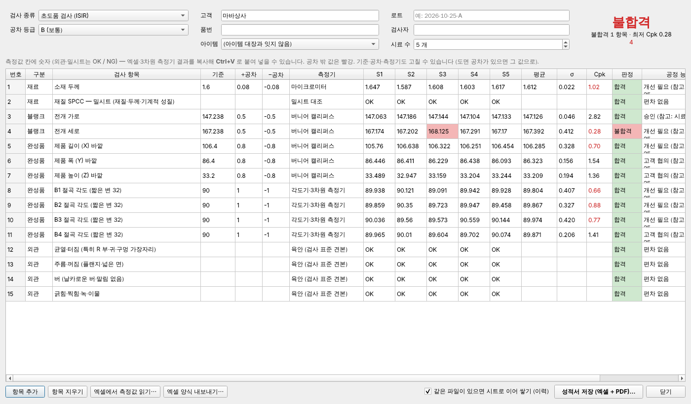

| 구분 | 검사 항목 | 공차 (도면에 없을 때) |
|---|---|---|
| 재료 | 소재 두께 · 밀시트 (재질·두께·기계적 성질) | JIS G 3141 냉연 강판 두께 허용차 (폭 630 미만) |
| 블랭크 | 전개 가로·세로, 구멍 지름, 구멍 중심 X·Y (전개도 원점) | JIS B 0408 打抜き (A·B·C 등급) |
| 완성품 | 제품 길이·폭·높이 (3D 바깥), 절곡 각도 | JIS B 0408 曲げ・絞り, ISO 2768-1 각도 (짧은 변 길이별, c 급) |
| 성형 | 성형 해석 문제 부위 (①②…) 의 두께 ≥ t × 75 % | 얇아짐 25 % 기준 |
| 외관 | 균열·주름·버·긁힘 (OK / NG) | 검사 표준 견본 |

- 측정값: 칸에 바로 넣거나, 엑셀·3차원 측정기 결과를 복사해 **Ctrl+V**. 공차 밖 값은 빨강. 기준·공차는 도면 값으로 고칠 수 있고
  [항목 추가] 로 평면도·피치 같은 항목을 더합니다.
- 공정 능력: Cp = (상한 − 하한) / 6σ, Cpk = min(상한 − 평균, 평균 − 하한) / 3σ. AIAG PPAP 기준 1.67 이상 승인, 1.33~1.67 고객 협의,
  1.33 미만 개선 필요 (시료 25 개 미만은 참고값).
- **엑셀 성적서**: 측정값 칸만 채우면 엑셀이 평균·σ·Cp·Cpk·판정을 바로 계산하는 식이 들어 있습니다 ([엑셀 양식 내보내기] 로
  빈 양식을 현장에 주고 [엑셀에서 측정값 읽기] 로 되읽기). 같은 파일에 다시 저장하면 **검사 회차마다 시트가 쌓이고 [이력] 시트에 한 줄**.
- PDF 성적서 (작성·검토·승인 칸), [견적·금형 기록] 에 '검사 성적서'. 부품 한 번에 분석은 `09_…_검사성적서.xlsx` 양식을 만듭니다.

## 성형 해석 설명 (1.32.0)

성형 해석이 색 그림만 보여 주지 않고 **어디가 · 얼마나 · 왜 · 어떻게 고치는지** 를 글로 씁니다
(해석 창 첫 탭 [설명 (원인 · 대책)], 엑셀 [해석 설명] 시트, PDF 설명 쪽).

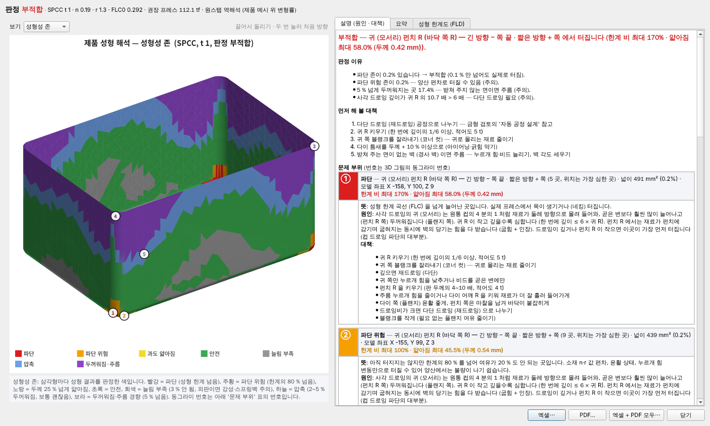

- **문제 부위**: 같은 성형성 존 (파단 · 파단 위험 · 과도 얇아짐 · 두꺼워짐 · 늘림 부족) 삼각형을 이어 덩어리로 묶고
  번호를 붙입니다 — 3D 그림에도 같은 번호 동그라미.
- **위치 이름**: 프레스 방향 높이와 면 기울기로 바닥 (펀치 면) · 펀치 R · 벽 · 다이 어깨 R · 플랜지 (누르개 면),
  사각 드로잉이면 귀 (모서리), 잘린 가장자리 (트림선·구멍), 가운데에서 본 방향과 모델 좌표 (X, Y, Z).
- **값 · 뜻 · 원인 · 대책**: 존 × 위치별 (예: 귀 펀치 R 파단 → 귀 R 키우기 · 코너 컷 · 재드로잉 · 펀치 R 4~10 t,
  플랜지 두꺼워짐 → 누르개 힘·드로잉 비드, 외판 늘림 부족 → 락 비드로 2~3 % 넘게 스트레치).
- **판정 이유 · 먼저 해 볼 대책 · 위치별 두께 표 · 두께 변화 분포 · 공정·하중 설명 · 그림 읽는 법** (보기 5 가지와 FLD).
- 판금 절곡 부품은 최소 R 보다 작은 절곡마다 원인·대책과 스프링백 보정 설명.
- 참고: Marciniak·Duncan·Hu *Mechanics of Sheet Metal Forming*, Schuler *Metal Forming Handbook*,
  AutoForm Formability 판정, 日本塑性加工学会『プレス加工便覧』, AHSS Application Guidelines.

## 자동차 부품 시험 (1.31.0)

후드 · 휀다 · 오일 팬 (깊은 사각 드로잉) 시험 모델로 전개·성형 해석을 돌려 찾은 문제를 고쳤습니다 —
큰 외판 메시 (125 초 → 16 초), 가장자리 바늘 삼각형, 가파른 벽 트림선의 가짜 늘림, 깊은 상자의 프레스 방향,
사각 드로잉 귀 R 판정 (**깊이 ≤ 6 × 귀 R**, 넘으면 재드로잉). 결과와 고친 것: [docs/자동차_부품_시험.md](docs/자동차_부품_시험.md)

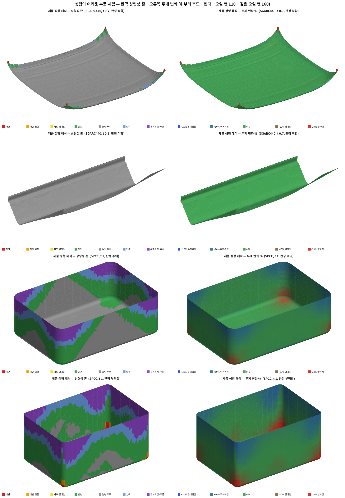

## 미국 문헌 반영 (1.30.0)

| 분야 | 반영한 것 | 출처 |
|---|---|---|
| 금형 · 프레스 선택 | **크랭크 프레스 톤수 곡선**: 정격 톤수는 하사점 앞 30° (ISO) 까지, 그 위는 F = P · sin 30° / sin α. 드로잉은 깊이 − 10 t (펀치 R + 다이 R 을 지난 뒤) 높이에서 가장 큰 힘이 걸린다고 보고 그 높이에서 쓸 수 있는 힘으로 프레스를 고르고, **행정 ≥ 2 × 깊이** (부품 빼내기) 도 봄 — [기계·임률] 표에 **행정 mm** 칸 | The Fabricator 「Understanding press tonnage」 |
| 해석 · 가장자리 균열 | **구멍 확장률 HER** (ISO 16630): 잘린 가장자리 (트림선·구멍) 의 둘레 방향 늘림을 메시에서 재서 HER 과 견줌 — 구멍 버링·스트레치 플랜지 균열. 연강·일반 고장력강 100 %, AHSS (SPFC590·980) 50 % | AHSS Insights, The Fabricator 「edge cracking in hole flanging of AHSS」 |
| 금형 설계 | 전단력이 크면 **시어 각** (경사 날) — 펀치 각 16° 로 전단력 최대 80 % 감소 (시험) 안내 | Trans. FAMENA 40 (2016) |

이미 쓰고 있던 미국 문헌: Keeler-Brazier FLC0, Kalpakjian 스프링백·최소 굽힘 R (Datsko·Yang), Machinery's Handbook·SME 굽힘력
1.33·σb·L·t²/V, Hosford·Caddell LDR (1.29), AHSS Insights n·r 값.

예: 원통 컵 Ø100 × 50 (SPCC) 드로잉은 하사점 위 40 mm 에서 힘이 가장 커서, 행정 150 mm 프레스의 쓸 수 있는 힘이 57 % —
60 톤 대신 **110 톤** 프레스를 고릅니다.

## 문헌 검토

프로그램의 계산식·표·규칙을 문헌·교재·논문과 맞춰 본 결과는 [docs/문헌_검토.md](docs/문헌_검토.md) 에 있습니다
(맞음 / 고침 / 확인 못함, 출처).

## 화면 구성 (큰 분류)

맨 위 **분류 탭**(과 같은 이름의 메뉴)으로 기능을 나눴습니다. 탭을 고르면 그 분류의 단추만 보이고, 오른쪽에 무엇을 하는 곳인지
한 줄 설명이 나옵니다. 마지막에 본 탭을 기억합니다. 단축키는 어느 탭을 보고 있어도 됩니다.

| 분류 | 단추 | 단축키 |
|---|---|---|
| 파일 | 열기 · **부품 한 번에 분석** · **전체 분석** · 여러 파일 한꺼번에 · ZIP 만들기 | Ctrl+O · Ctrl+Shift+P · Ctrl+Shift+A |
| 전개 | DXF 저장 · 보고서 PDF · 보고서 엑셀 · **성형 해석** · 조립도 PDF · [DXF 에 절곡 글씨 넣기] | Ctrl+S · Ctrl+M |
| 네스팅 | 철판 배치 | Ctrl+N |
| BOM | BOM · AI BOM | Ctrl+B |
| 금형 | 성형 해석 · 금형 검토 · 금형 공정 (자동 공정 설계·공정도) · **금형비 계산** | Ctrl+M · Ctrl+K · Ctrl+J · Ctrl+Shift+K |
| 견적 | **아이템 대장** · 전체 분석 · 견적 · **생산 견적** · **원가계산서** · 금형비 계산 · 견적·금형 기록 | Ctrl+I · Ctrl+E · Ctrl+Shift+K |
| 품질 | 성형 해석 · **품질 문서** (공정 흐름도 · PFMEA · 관리계획서) | Ctrl+M |
| 기록 | 전개 기록 · 견적·금형 기록 · [전개 기록 남기기] | Ctrl+H |
| 설정·도움말 | 도움말 · **프로그램 정보** (제작사) · [그래픽 가속] | |

그 아래 줄은 어느 분류에서나 쓰는 **작업 줄**: 전개 방식 · 부품 · 두께 · 치수.

## 사용법

1. **[열기]** 또는 STEP 파일을 창에 끌어다 놓기
2. 왼쪽에 3D 형상, 오른쪽에 전개도, 아래에 절곡 목록이 나옵니다.
3. 아래 **[절곡 조건]** 에서 재질·계산 방법·상형 R 을 고릅니다 (아래 "연신 계산" 참고).
4. **[DXF 저장]**

### DXF 레이어

| 레이어 | 내용 | 색 |
|---|---|---|
| `CUT` | 외곽선, 구멍 (절단) | 흰색 실선 |
| `BEND` | 절곡선 (절곡부 가운데) | 노란색 점선 |
| `NOTE` | `B1 UP 90.0° R2.00` 같은 절곡 글씨, 두께·크기 | 초록색 |

가공기로 보낼 때는 `NOTE` 레이어를 끄거나, 툴바의 **[DXF 에 절곡 글씨 넣기]** 를 끄고 저장하세요.
구멍과 라운드는 원·호로, 직선은 선으로 정확히 나옵니다.

### 방향 (UP / DOWN)

DXF 를 화면에 놓고 위에서 본다고 할 때

- **UP** : 플랜지가 보는 사람 쪽으로 올라옴
- **DOWN** : 반대쪽으로 내려감

## 연신(굽힘 공제) 계산

현장에서 말하는 **연신**은 90° 한 번 접을 때 바깥 치수 합에서 빼는 길이입니다.

```
전개 길이 = 바깥 치수 합 − Σ 연신
연신 BD   = 2·tan(θ/2)·(R + t) − BA        (90° 이면 2(R + t) − BA)
펼친 절곡부 BA = θ·(R + K·t)
```

화면 아래 **[절곡 조건]** 에서 정합니다.

| 항목 | 내용 |
|---|---|
| 계산 방법 | **K 계수 직접 입력** / **재질별 K 표** (문헌 [1]) / **DIN 6935 공식** (문헌 [2]) |
| 재질 | SPCC, SPHC, SECC, SGCC, SS275, 자동차용 SAPH440·SGARC440·SPFC590·SPFC980, SUS304, SUS430, AL5052, AL1050, AL6061, C1100(동), C2600(황동) |
| 가공 방식 | 에어 벤딩 / 바텀 벤딩 / 코이닝 — K 표의 행이 바뀝니다 |
| 상형 R · 하형 V | 켜면 3D 모델의 R 대신 **실제 절곡 R** 로 다시 계산합니다. 도면의 바깥 치수는 그대로 두고 연신만 바뀝니다 |
| 회사 연신 표 | 현장에서 시험 절곡으로 잰 값. 있으면 문헌값보다 먼저 씁니다 |

### 실제 R 은 어떻게 정하나

- **에어 벤딩**: 상형 R 이 작으면 판이 상형을 따라가지 않고 하형 V 폭에 비례하는 R 로 휩니다 (문헌 [3]).
  `실제 R = max(상형 R, V 폭 × 재질 비율)` — 냉연강 16 %, SUS304 21 %, AL5052 12 % 등.
  V 폭을 비워 두면 두께의 8배로 봅니다.
- **바텀 벤딩 · 코이닝**: 상형 R 그대로.

### 연신 표

**[연신 표 보기 · 입력…]** 을 누르면 재질마다 **두께(0.5~6.0) × 상형 R(0.2~6)** 의 90° 연신 표가 나옵니다.
칸에 마우스를 올리면 실제 R · K · 근거가 보입니다.
**현장에서 잰 값을 칸에 넣으면** 노란 칸으로 바뀌고, 전개할 때 그 값을 씁니다
(그 값에서 K 를 거꾸로 구해 90° 가 아닌 각도에도 적용). CSV 로 저장할 수 있습니다.
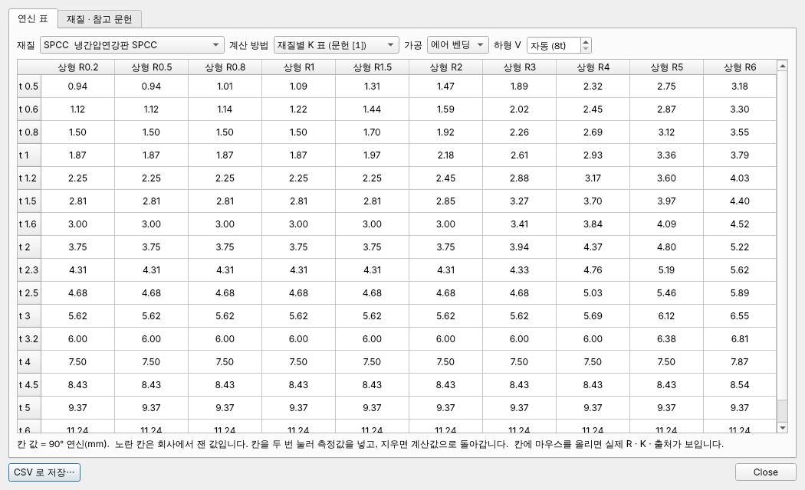

입력한 값은 `%APPDATA%\HanilUnfold\연신표.json` 에 남습니다.

### 참고 문헌

1. **일반 K 계수 표** (에어·바텀·코이닝 × 연질·중간·경질). Machinery's Handbook 계열 표로 여러 판금 실무서와
   The Fabricator 기사에 같은 값이 실려 있습니다.
   에어 벤딩 기준 R ≤ t: 0.33 / 0.38 / 0.40, t~3t: 0.40 / 0.43 / 0.45, 3t 초과: 0.50.
2. **DIN 6935** Kaltbiegen von Flacherzeugnissen aus Stahl — 보정 계수 `k = 0.65 + 0.5·log10(R/t)` (R/t < 5), 중립 K = k/2.
3. **The Fabricator 절곡 연재의 "20% 규칙"** — 에어 벤딩 안쪽 R 은 하형 V 폭의 일정 비율 (냉연강 15~17 %, SUS304 20~22 %,
   AL5052-H32 약 11~13 %). 그 밖의 재질은 인장강도에 비례해 어림했습니다 (표의 "근거" 칸에 "어림" 으로 표시).

> **문헌값은 출발점입니다.** 문헌들도 정확한 값은 시험 절곡으로 확인하라고 합니다.
> 자주 쓰는 재질·두께·상형 R 은 시험 절곡 후 연신 표에 넣어 두시길 권합니다.
> DIN 공식은 규격 원문(유료)이 아니라 교재에 널리 실린 식을 썼습니다.

## 성형품 (자동차 부품 같은 곡면 제품)

프레스로 당겨 만든 자유곡면은 종이처럼 펼 수 있는 면이 아니라서, 정확한 전개도가 존재하지 않습니다.
그래서 성형 해석 프로그램의 **원스텝 블랭크 추정**과 같은 생각으로 근사합니다.

1. 제품 겉면을 잘게 삼각형으로 나누고 두께 가운데 면으로 옮깁니다.
2. 등각 사상(LSCM)으로 처음 펼친 뒤, ARAP 반복으로 각 삼각형이 될 수 있는 한 늘거나 줄지 않게 다듬습니다.
3. **원스텝 역해석 (1.14.0)**: ARAP 블랭크에서 시작해, 블랭크가 한 번에 제품으로 변형될 때 드는
   **소성 일이 가장 작은 블랭크**를 찾습니다 (Dynaform MSTEP·ANSA Inverse Forming·AutoForm 원스텝과 같은 생각,
   Lee & Huh 1998 의 최소 소성 일 법).
   - 재료: 가공 경화 지수 **n** (σ = K·εⁿ), 수직 이방성 **r** (Hill 1948) — [재질] 에서 고른 재질의 대표값.
   - 등가 변형률 ε̄ = (1+r)/√(1+2r) · √(ε1² + ε2² + 2r/(1+r)·ε1·ε2), 소성 일 = Σ 넓이 · ε̄ⁿ⁺¹/(n+1).
   - **1.24.0**: 소성 일을 제품과 블랭크의 **중간 형상**(두 넓이의 기하 평균)에서 적분합니다 — 비례 변형 경로의
     일을 중점 규칙으로 잰 것. 제품 넓이로만 재면 얇아진 곳을 무겁게 세어 블랭크가 커지고, 블랭크 넓이로만 재면 작아집니다.
   - **금형 작용 (1.24.0)**: Batoz·Guo 역해석의 확장(Naceur 외 등가 마찰 하중)처럼 금형을 등가 외력으로 넣습니다.
     펀치 바닥(누르는 방향과 10° 안의 면)의 마찰 μ = 0.1, 블랭크 바깥 끝의 주름 누르개 마찰 (재질별 면압) 과
     다이 R(5t) 굽힘-펴짐 저항 (Swift: σ·t/(2R+t)), 다이 R 감김 마찰 e^(μπ/2).
   - 풀이: 투영 뉴턴법 (삼각형마다 헤세 행렬을 양의 반정부호로 잘라 모음) + 삼각형이 뒤집히지 않는 걸음.
     부품 하나에 4 초까지 (조립품 [전체 계산] 이 너무 오래 걸리지 않게).
   - ARAP 는 길이만 지키려 해서 **두께가 바뀌는 것(넓이 변화)을 싸게** 봅니다. 그래서 딥 드로잉 컵의 바닥까지
     30 % 얇아진다고 보고 블랭크를 작게 잡았습니다. 원스텝은 재료가 흘러 들어오는(드로잉) 변형을 고릅니다.
4. 삼각형마다 블랭크 → 제품 넓이 비로 **두께 변화**를 어림합니다 (체적 일정).
5. **성형 한계 (FLC) 판정 (1.14.0)**: 삼각형마다 (부 변형률 ε2, 주 변형률 ε1) 을 성형 한계 곡선과 견줍니다.
   - 강판: Keeler-Brazier 식 FLC0 [%] = (23.3 + 14.17·t)·n / 0.21 (t 두께 mm, 3 mm 까지 — 원식은 인치로 23.3 + 360·t).
     왼쪽(ε2 < 0)은 두께 감소가 FLC0 와 같은 선, 오른쪽(ε2 > 0)은 기울기 0.6.
   - 알루미늄·스테인리스·동은 식이 맞지 않아 재질 표의 대표 FLC0 를 씁니다.
   - 한계를 넘는 곳(파단 위험), 80 % 이상(여유 적음), 5 % 넘게 두꺼워지는 압축(주름 가능) 넓이 비를 경고로 알립니다.
   - 오른쪽 아래 정보의 **성형 한계도 보기** (또는 전개도 오른쪽 단추 메뉴) → 성형 한계도(FLD) 창.
     엑셀 보고서 [두께 변화] 시트에도 FLD 그림과 판정 값이 들어갑니다.

| 재질 | n | r | FLC0 (진변형률, t = 1 mm) |
|---|---|---|---|
| SPCC · SECC · SGCC | 0.19 · 0.19 · 0.18 | 1.3 · 1.3 · 1.2 | 0.29 (Keeler) |
| SPHC · SS275 | 0.18 · 0.17 | 1.0 | 0.28 · 0.27 (Keeler) |
| SAPH440 · SGARC440 · SPFC590 · SPFC980 | 0.16 · 0.17 · 0.15 · 0.08 | 0.9 · 1.1 · 0.9 · 0.8 | Keeler |
| SUS304 · SUS430 | 0.45 · 0.20 | 1.0 · 1.2 | 0.40 · 0.22 |
| AL5052 · AL1050 · AL6061-T6 | 0.13 · 0.10 · 0.05 | 0.7 · 0.6 · 0.7 | 0.18 · 0.20 · 0.08 |
| C1100 · C2600 | 0.30 · 0.40 | 0.9 | 0.30 · 0.35 |

(n·r·FLC0 은 문헌의 **대표값**입니다. 소재 성적서(밀시트)의 n·r 이 다르면 결과도 달라집니다.)

[전개 방식] 이 **자동** 이면, 평면·원통·원뿔로만 된 부품은 판금 정확 전개, 자유곡면이 있으면 성형품 근사 전개로
저절로 바뀝니다. 화면과 보고서에 두께 변화 색 지도가 나옵니다 (**파랑 = 두꺼워짐·주름 위험, 빨강 = 얇아짐·터짐 위험**).

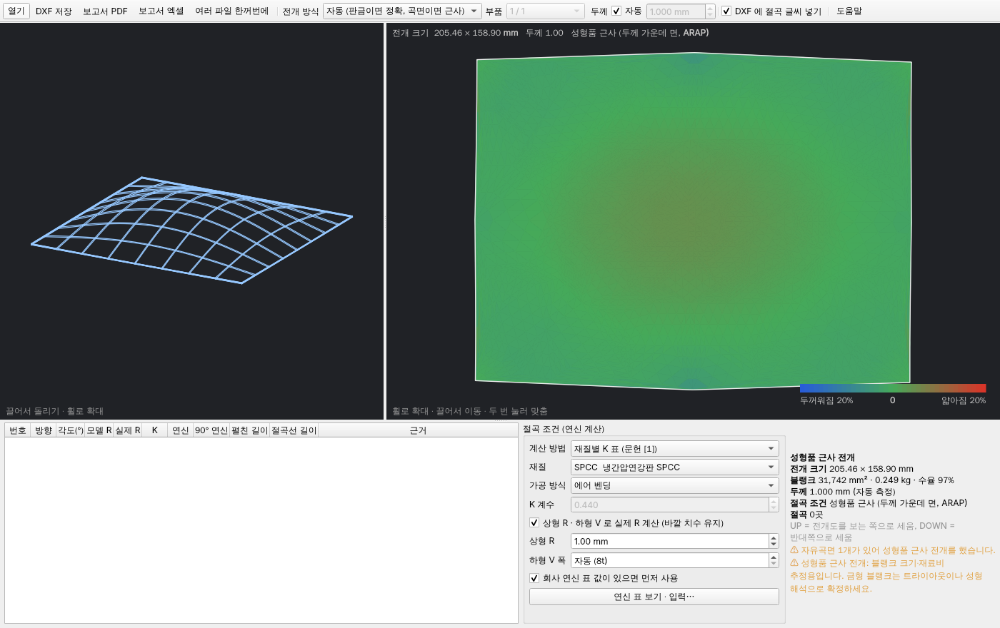

> **블랭크 크기·재료비 추정용**입니다. 금형 블랭크는 트라이아웃이나 성형 해석(AutoForm 등)으로 확정하세요.
> 블랭크 홀더·펀치 마찰·다이 R 은 등가 외력으로 어림합니다 (1.24.0). 드로잉 비드와 다단 공정 이력은 들어가지 않습니다.

시험 (SPCC):

| 형상 | ARAP (1.13) | 원스텝 (1.14~1.23) | 원스텝 + 중간 형상 + 금형 작용 + 고른 메시 (1.25) |
|---|---|---|---|
| 딥 드로잉 원통 컵 Ø100 × 50, 바닥 R8 (같은 넓이 블랭크 Ø167.6) | Ø153, 바닥 31 % 얇아짐 | Ø177.6 (+6 %), 바닥 0 %, 벽 위 54 % 두꺼워짐 | **Ø169.0 (+0.8 %)**, 바닥 2 % 얇아짐, 벽 위로 갈수록 두꺼워져 끝 +10 % (블랭크 넓이 = 제품 × 1.02, 체적 일정) |
| 사각 드로잉 상자 100 × 100 × 50, R8 | 블랭크/제품 넓이 0.88 | 0.99 | — |
| 구면 접시 R150 깊이 40 · 두께 변화 | ±7 % | ±3 % | −2 ~ +3 % (넓이 비 1.00) |
| 자유곡면 패널 · 두께 변화 | −3 ~ +4 % | ±2 % | −1 ~ +3 % (넓이 비 1.00) |

판금 부품을 성형품 방식으로 펴도 두께 가운데(K=0.5) 정확 전개와 0.01 mm 안에서 같습니다.

**고른 메시 (1.25.0)**: CAD 메시는 원통 벽에 벽 높이만큼 긴 바늘 삼각형을 만들어, 이웃 삼각형끼리 변형률이
번갈아 튀었습니다 (+22 % / −28 % 체커보드). 기준 길이보다 긴 모서리를 모두 가운데서 나누고 (새 점은 법선으로
곡면 위로 올림), 그 결과 같은 높이의 벽은 두께 변화가 고르고 벽 위로 갈수록 두꺼워지는 실제 드로잉 컵 분포가 나옵니다.
금형 작용 (누르개·다이 R) 은 이중 곡면(자유곡면·구·토러스)이 있는 부품에만 넣습니다 — 평면·원통·원뿔뿐인 부품은 굽힘으로 만듭니다.

## 제품 성형 해석 (1.25.0)

전개하면 정보 칸에 **성형 해석** 판정 한 줄이 같이 나옵니다 (적합 · 주의 · 부적합). [성형 해석 보기] 링크나
[전개]·[금형] 탭의 **[성형 해석]** (Ctrl+M) 으로 창을 엽니다. 엑셀 · PDF 로 저장하고 [견적·금형 기록] 에 남습니다.
[보고서 엑셀] 에도 [성형 해석] 시트가 들어갑니다.

**성형품 (자유곡면)** — 원스텝 역해석의 삼각형별 변형률을 제품 3D 위에 칠합니다 (마우스로 끌어 돌리기).
- 보기: 성형성 존 · 두께 변화 % · 두께 mm · 주 변형률 · 성형 한계 비.
- 성형성 존 (AutoForm Formability 판정과 같은 구분):

| 존 | 기준 | 판정 |
|---|---|---|
| 파단 | 성형 한계 (FLC) 넘음 | 부적합 |
| 파단 위험 | FLC 아래 안전 여유 20 % 안 (LS-DYNA 기본값, 문헌 10~20 %) | 주의 |
| 과도 얇아짐 | 두께 25 % 넘게 얇아짐 (문헌 관례 25 % 또는 30 %) | 주의 |
| 안전 | | 적합 |
| 늘림 부족 | 얇아짐·주 변형률 3 % 미만 (스프링백·면 결함 기준 3~5 %) | 적합 (넓으면 알림) |
| 압축 | 압축으로 두꺼워짐 2~5 % | 적합 |
| 두꺼워짐·주름 경향 | 5 % 넘게 두꺼워짐 | 주의 (다이 벽에 눌리는 드로잉 벽이면 정상) |

- 값은 유한요소 후처리처럼 **절점 평균**(삼각형 → 꼭짓점 넓이 가중 → 삼각형) 으로 고른 뒤 판정합니다.
- 하중: 드로잉 F = 제품 둘레 × t × σb × n(m) (m = 제품 둘레 / 블랭크 둘레, 원통 드로잉 식을 둘레로 넓힘),
  얕은 성형은 둘레 × t × 유동 응력, 주름 누르개 = 면압 × (블랭크 − 펀치 투영 넓이). 권장 프레스 = 합 × 1.3.

**판금 (절곡)** — 절곡마다 바깥 면 공칭 변형률 e = 1/(2R/t + 1) 을 재질의 **최소 굽힘 R/t** (90°, 압연 방향과 직각)
에서의 값과 비교합니다 (Datsko·Yang, Kalpakjian: 굽힘은 두께 방향 변형률 기울기가 있어 FLC0 보다 훨씬 더 늘어나도
터지지 않음). 스프링백 보정 각, 굽힘력도 같이 나옵니다.

| 재질 | 최소 안쪽 R / t | 근거 |
|---|---|---|
| SPCC · SECC · SGCC | 0 (밀착) | JIS G 3141 180° 굽힘 밀착 (표준·소둔) |
| AL1050 · C1100 | 0 | 연질 대표값 |
| SPHC · SAPH440 · SGARC440 · SUS304 · C2600 | 0.5 | 재질 굽힘 시험 대표값 |
| SPFC590 | 1.0 | JIS G 3135 180° 1.0 t |
| SS275 · SUS430 · AL5052-H32 | 1.0 | 5052-H32 0~1 t (The Fabricator) |
| SPFC980 | 2.0 | DP980 냉연 90° 시험 Rmin/t ≈ 2.0 (Baosteel; JIS 980Y 180° 는 4.0 t) |
| AL6061-T6 | 2.5 | FAA AC 43.13 · 현장 자료 2~4 t |

바깥 면 늘어남은 접은 각이 아니라 R/t 로 정해지므로 180° 굽힘 시험값을 그대로 씁니다 (보수적).
압연 방향과 나란히 접거나 버(burr) 쪽이 바깥이면 더 크게 잡으세요.

**실험과 비교 (원통 컵)**: 실험 컵은 펀치 R 근처가 15~18 % 얇아지고 위 끝이 약 10 % 두꺼워집니다 (원통 컵 드로잉
실험 논문). 이 프로그램은 위 끝 +10.8 % 로 두꺼워짐은 맞고, 펀치 R 얇아짐은 2 % 로 작게 나옵니다 — 원스텝 해석의
알려진 한계 (굽힘-펴짐·마찰 이력이 없음, Guo·Batoz). 펀치 R 터짐은 [금형 검토] 의 드로잉률 계산과 같이 보세요.

> 원스텝 해석은 **한 번에 성형**한다고 보므로 다단 드로잉의 이력·드로잉 비드·실제 금형 형상은 들어가지 않습니다.
> 펀치 R 근처 얇아짐은 실제보다 작게 나오는 경향이 있습니다 (Guo·Batoz). 금형 확정 전에는 AutoForm 같은 증분 해석·시험으로 확인하세요.

### 성형품 참고 자료

- Lee C.H., Huh H., "Blank design and strain estimates for sheet metal forming processes by a finite element
  inverse approach with initial guess of linear deformation", J. Mater. Process. Technol. 82 (1998) — KAIST 최소 소성 일 역해석
- Guo Y.Q., Batoz J.L. 외, "Etude de l'emboutissage des tôles minces par l'approche inverse" / "Finite element procedure
  for strain estimations of sheet metal forming parts", Int. J. Numer. Meth. Eng. 30 (1990) 1385–1401 — 원스텝 역해석의 시작
- Naceur H., Guo Y.Q., Batoz J.L. 외, 역해석에 블랭크 홀더·마찰·드로잉 비드를 등가 외력으로 넣는 확장 (IJMS 2001 외)
- Chung K., Richmond O., "Ideal forming", Int. J. Mech. Sci. 34 (1992) — 최소 소성 일 (이상 성형) 이론
- Swift H.W. (1952), Siebel — 다이 R 굽힘-펴짐 · 감김 마찰을 넣은 드로잉 응력
- AutoForm, *Formability* 판정 (Splits · Risk of splits · Excess thinning · Safe · Insufficient stretch · Compress · Thickening)
- Datsko J., Yang C.T., "Correlation of bendability of materials with their tensile properties", J. Eng. Ind. 82 (1960);
  Kalpakjian S., *Manufacturing Processes for Engineering Materials* — 최소 굽힘 반지름 R/t = 50/RA − 1
- Aluminum Association, *Aluminum Standards and Data* — 90° 굽힘 반지름 표 · JIS G 3141/3131/3101/3113/3135 굽힘 시험
- BETA CAE Systems, *ANSA Inverse Forming* (원스텝 역해석 · 블랭크 추정)
- ETA, *Dynaform MSTEP* 사용 설명서 (원스텝 블랭크·성형성)
- S. Keeler, "Forming Limit Curves", MetalForming 2019-07 (Keeler-Brazier FLC0 식)
- AHSS Insights (WorldAutoSteel), *Forming Limit Curves*, *n-value* (강종별 n·FLC)
- Rabinovich M. 외, "Scalable Locally Injective Mappings", ACM TOG 2017 · Teran J. 외 "Robust Quasistatic Finite
  Elements" 2005 (투영 뉴턴 · 뒤집힘 없는 걸음)

## 보고서 (PDF · 엑셀)

툴바 **[보고서 PDF]** · **[보고서 엑셀]**.

| 항목 | 내용 |
|---|---|
| 부품 정보 | 파일, 부품, 전개 방식, 재질, 두께, 계산 조건 |
| 재료 | 전개 크기, 블랭크 넓이, 사각 원판 넓이·**수율**, **블랭크 무게**(재질 비중), 사각 원판 무게 |
| 가공 | **절단 길이**, 피어싱 수, 구멍 수, 절곡 수 |
| 그림 | 치수가 들어간 전개도, 3D 형상 (성형품은 두께 변화 색 지도) |
| 절곡 표 | 방향, 각도, 모델 R·실제 R, K, 연신, 90° 연신, 펼친 길이, 근거 |
| 성형품 | 제품 면적, 블랭크/제품 면적 비, 최대 얇아짐·두꺼워짐, 두께 변화 분포(엑셀 [두께 변화] 시트) |

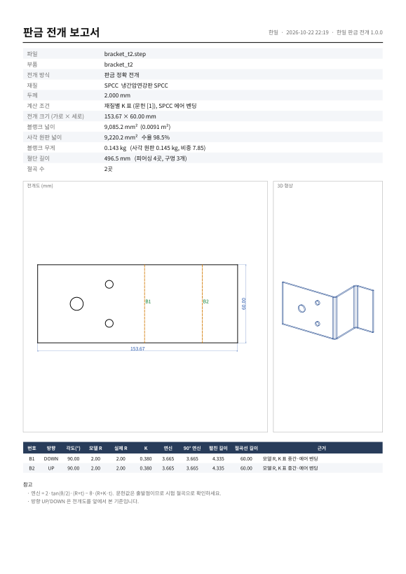

엑셀에는 숫자 값도 따로 넣어 두어 견적 계산에 바로 쓸 수 있습니다.
**[여러 파일 한꺼번에]** 에서 보고서를 함께 만들면 `parts_list.xlsx` (부품마다 한 줄, 무게 합계)도 생깁니다.

## 기본 치수 · 두께 · 면적

툴바 **[치수]** 를 켜면 (기본 켜짐) 전개도에 기본 치수와 요약이 나옵니다. 원점은 전개도 왼쪽 아래입니다.

| 항목 | 내용 |
|---|---|
| 요약 상자 | **두께**, 전개 크기, **블랭크 면적**(구멍 뺌, m² 함께), 사각 원판 면적·수율, **무게**, 절단 길이·피어싱 수 |
| 전체 크기 | 가로·세로 (바깥 줄) |
| 절곡선 위치 | 세로 절곡선은 X, 가로 절곡선은 Y. 끝 → 절곡선 → … → 끝 **연속 치수**(플랜지 길이, 안쪽 줄) |
| 구멍 | H1, H2 … 번호, 둥근 구멍은 **Ø지름**, 장공·사각은 가로×세로, 중심 X·Y |

- 아래 **[치수 · 면적]** 탭에 같은 값이 표로 나옵니다 (외곽 면적·구멍 위치 포함).
- **DXF** 의 `DIM` 레이어에 CAD 에서 고칠 수 있는 진짜 치수 객체로 들어가고, `NOTE` 레이어에 두께·면적·무게·절단 길이가 적힙니다.
  가공기로 보낼 때는 `DIM`·`NOTE` 레이어를 끄면 됩니다 (명령줄은 `--no-dims`).
- **PDF·엑셀 보고서** 에도 치수선이 들어간 전개도와 치수 표(엑셀 [치수] 시트)가 붙습니다.

## 조립품 (전체 그림 · 번호)

여러 부품이 든 STEP(조립품)을 열면 왼쪽 **[조립품 전체 (번호)]** 탭에 모든 부품이 그려지고, 부품마다 **번호 풍선**이 붙습니다.

- 번호를 누르거나 오른쪽 목록에서 고르면 그 부품이 주황색으로 강조되고 전개도가 바로 바뀝니다.
- STEP 에 부품(제품) 이름이 들어 있으면 `7. 61900-SWICO TAILGATE FRAME …` 처럼 이름도 함께 나옵니다.
  같은 부품이 여러 개 조립돼 있으면 `#2`, `#3` 을 붙여 구분합니다. 이름이 없는 파일은 `부품 N` 입니다.
- 번호는 **[부품] 목록, 전개 기록, 보고서, 일괄 처리 파일 이름(`_7_flat.dxf`)** 에서 모두 같습니다.
- **[조립도 PDF]** — A3 가로 한 장에 번호 풍선이 달린 조립품 그림, 다음 쪽부터 번호·부품명·크기 표.
  [여러 파일 한꺼번에] 에서 보고서를 함께 만들면 조립품마다 `_assembly.pdf` 도 만들어집니다.
- **[전체 계산]** — 모든 부품을 한 번에 전개해 목록에 부품마다 두께·면적·무게를 붙이고,
  **블랭크 면적·무게·절단 길이 합계**와 **두께별 합계**(t1.2 × 2개 · 0.61 m² · 5.7 kg …)를 보여 줍니다.
  펼칠 수 없는 부품(파이프 등)은 따로 표시합니다. **[엑셀로]** 는 [두께별 합계]·[부품별] 시트로 저장합니다 (철판 발주용).
- 부품이 100개 넘는 조립품도 바로 열립니다. 자유곡면 되돌리기 같은 손질은 고른 부품에만 합니다.

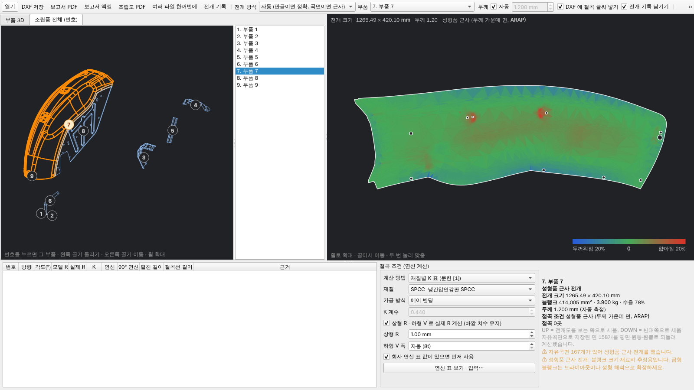

## 전개 기록 (누적 저장)

전개한 부품은 **자동으로 기록이 쌓입니다** (툴바 [전개 기록 남기기], 기본 켜짐).

- 남는 것: 전개 일시, 파일·부품, 재질, 두께, 가로·세로, 블랭크 넓이·무게·수율, 절단 길이, 절곡(각도·R 묶음), 계산 조건, 주의 사항,
  그리고 **전개도 DXF 사본** (월별 보관함 폴더).
- 같은 날 같은 부품을 다시 전개하면(K 계수를 바꿔 보는 등) 새 줄 대신 최신 값으로 **갱신**합니다. 다른 날 다시 전개하면 새 줄이 생겨 이력이 남습니다.
- 사용자가 따로 저장한 DXF·보고서 경로도 그 기록에 붙습니다. [여러 파일 한꺼번에] 와 명령줄 변환도 기록됩니다 (`--no-history` 로 끔).

**[전개 기록]** (Ctrl+H) 창에서

| 기능 | 내용 |
|---|---|
| 찾기 | 파일 이름·재질·메모, 기간 |
| 합계 | 찾은 기록의 블랭크 무게·절단 길이 합계 |
| 보관 DXF 열기 / 원본 다시 열기 | 두 번 누르면 보관 DXF 가 열립니다 |
| 메모 | 주문처·수량·도면 번호 등 |
| 엑셀로 내보내기 | 찾은 기록 전체(여러 줄을 고르면 그 줄만), 무게 합계 포함 |
| 보관 위치 바꾸기 | **공유 폴더**로 지정하면 여러 PC 의 기록을 한곳에 모을 수 있습니다 |

기본 위치: `%APPDATA%\HanilUnfold\기록\` (`history.sqlite` + `보관함\2026-10\00001_부품_flat.dxf` …)

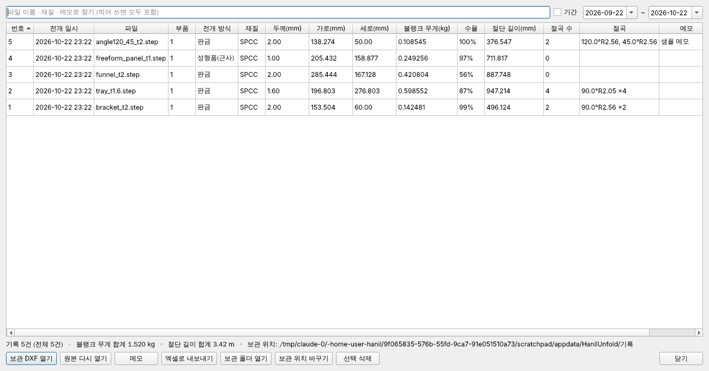

## 전개할 수 있는 형상

- **R 없이 꺾은 판** (설계에서 절곡 R 을 넣지 않은 ㄷ 형강·모자 단면·상자): 날카로운 모서리를 R 0 절곡으로 보고
  K 계수로 연신을 계산합니다 ([상형 R] 을 켜면 그 R 로). 두께 면(옆면)·끝면·용접한 T 자 이음은 접지 않습니다.
- **단면이 곡선인 판** (S 자·물결·아치, 단면이 3차 베지어·B-스플라인): 곡선 단면으로 정확 전개 (1.42.0, 위 참고)
- **곡면만 있는 판금 파일** (두께 없는 서피스): 두께를 물어 두껍게 만들어 엶 (1.42.0)
- **곡선을 따라 꺾인 판** (붐 암처럼 휜 외곽을 따라 프레스로 접은 ㄷ 단면): 정확한 전개가 안 되므로
  [판금] 을 골라도 성형품 근사로 펼치고 알립니다 (블랭크 크기·재료비 추정용).
- **곡면만 담긴 IGES**: 솔리드가 없으면 곡면을 꿰매(허용 오차 0.01 → 0.5 mm) 닫힌 것마다 부품으로 엽니다.
- 펼친 면적 × 두께가 부품 부피의 85% 보다 적거나 120% 보다 많으면 경고합니다
  (전개에 빠진 부분이 있거나, 두께가 일정한 판금이 아닌 부품: 너트·블록·보스 등).
- 두께가 일정한 판금 부품 (솔리드)
- **어떤 각도의 절곡이든** — 30°, 45°, 60°, 120°, 135°, 헤밍(거의 180°)
- **비스듬한 절곡선**, 절곡선과 비스듬히 잘린 외곽 (절곡부에 걸친 사선은 펼친 곡선으로 나옴)
- ㄱ·ㄷ·Z 자, 상자·트레이, 둥글게 만 관
- **원뿔** — 깔때기(원뿔대)는 부채꼴로, 원뿔 절곡은 그대로 펼침 (중립면 기준)
- 플랜지나 절곡부에 뚫린 구멍

자유곡면(자동차 패널, 엠보, 사각→원형 덕트 등)은 위의 **성형품 근사 전개**로 펼칩니다.
용접으로 붙인 조립품은 부품마다 따로 STEP 으로 저장해서 여세요 (여러 솔리드가 든 파일은 [부품] 에서 고릅니다).
펼친 플랜지끼리 겹치면 경고를 띄웁니다 (모서리 따내기가 필요한 경우).
이런 면이 있으면 전개도 아래에 경고가 뜹니다.

## 속도 (큰 조립품)

- **그래픽 가속**: 3D 화면을 그래픽 카드(OpenGL 2.1 이상)로 그립니다. 부품을 면으로 나눠 한 번만 그래픽 카드에 올리고,
  돌리기·확대·이동은 그래픽 카드가 처리합니다. 부품을 누르면 그 부품을 고릅니다.
  그래픽 카드를 못 쓰는 PC(원격 데스크톱, 아주 오래된 내장 그래픽)는 저절로 예전 방식으로 그립니다.
  툴바 [그래픽 가속] 으로 끌 수 있습니다 (다시 시작하면 적용).
- **다시 열기 보관**: 한 번 연 STEP 은 빠른 형식(형상·부품 이름·화면용 메시)으로 `%LOCALAPPDATA%\HanilUnfold\cache` 에 두고,
  같은 파일(경로·크기·수정 시각이 같을 때)을 다시 열면 그것을 씁니다. 최근 15개만 남깁니다.
- **처음 열기**: 부품 이름만 읽고(색·레이어·주석은 건너뜀), 형상 보정과 자유곡면 되돌리기는 고른 부품에만 합니다.
- **번호 풍선**: 화면이 멈췄을 때 한 번만 배치합니다. 부품이 40개 넘으면 기본으로 고른 부품 번호만 보입니다 ([번호 모두 보기]).

13.5MB · 128개 부품 테일게이트 프레임 조립품 기준 (시험 PC)

| 항목 | 전 | 후 |
|---|---|---|
| 처음 열기 | 약 12초 | 약 6초 |
| 다시 열기 | 약 12초 | 0.4초 |
| 조립품 화면 다시 그리기 | 부품·풍선 수에 비례해 수 초 | 그래픽 카드 처리 (풍선 배치 0.2초, 한 번만) |
| 곡면 부품 하나 전개 | 2.3초 | 1.2초 |
| 128개 전체 계산 | — | 약 9초 |

## BOM (부품표) — 생산용 다단계 BOM

툴바 **[BOM]** (Ctrl+B). 일반적인 BOM 정리 방법을 따릅니다:

- **설계 BOM(EBOM) → 생산 BOM(MBOM)**: CAD 구조(EBOM)에 생산에 필요한 것(소재·조달·공정)을 붙인 생산용 BOM 을 만듭니다.
- **다단계(인덴트) BOM, 정전개**: 위 품목(모품목)에서 아래(자품목)로 내려가며, 수량은 바로 위 1 개당, **합계** 는 완제품 1 대당.

| 레벨 | 품목 | 품번 | 예 |
|---|---|---|---|
| 0 | 완제품 | A00 | STEP 맨 위 조립품 (없으면 파일 이름) |
| 1+ | 반제품 (조립품) | SA01… | STEP 의 하위 조립품. 같은 하위 조립품은 한 번만 펼치고 수량으로 |
| 부품 | 자작 부품 / 표준품 / 구매품 | P001… | 같은 부품(옮기거나 돌린 것 포함)은 한 줄 |
| 그 아래 | 원자재 | RM-SPCC-T1.6, RM-…-RB30 | 자작 부품의 소재 (판재·환봉·각재, kg) |

**분류 규칙** (엑셀 [분류 기준] 시트에도 있음)

| 품목 유형 | 조달 | 공정 | 판단 |
|---|---|---|---|
| 자작 부품 (판금) | 자작 | 레이저 절단 → 절곡 N회 | 두께 일정·정확 전개·절곡 있음 |
| 자작 부품 (판재) | 자작 | 레이저 절단 | 절곡 없는 평판 |
| 자작 부품 (프레스 성형) | 자작 | 블랭킹 → 프레스 성형 | 곡면이 있어 근사 전개 |
| 자작 부품 (선반 가공) | 자작 | 환봉 절단 → 선반 가공 | 판금 아님, 축대칭, 50 mm 넘음 (부싱·축) |
| 자작 부품 (가공) | 자작 | 절단 → 기계 가공 | 판금도 축대칭도 아닌 덩어리 |
| 표준품 | 구매 | 구매 (규격품) | 이름에 볼트·너트·와셔·나사·핀·리벳·M8…, 또는 작은 축대칭(너트·와셔·핀 추정) |
| 구매품 | 구매 | 구매 | 이름에 베어링·부싱·힌지·가스스프링·실린더·램프·고무·클립·손잡이… |
| 원자재 | 구매 | — | 판재: 전개 사각 크기 × 두께 × 밀도 (kg), 순중량은 블랭크 면적 기준 |

**엑셀 시트**: BOM(계층, 왼쪽 + / − 로 반제품 접기·펼치기, 부품 3D 그림) · 부품 합계(완제품 1 대당) ·
원자재 소요량(재질·두께별 kg·수율) · 구매·표준품(발주용) · 분류 기준. **PDF**: A4 가로 계층 표.
[제외] 한 부품은 회색, 합계에서 빠집니다. 명령줄: `HanilUnfold.exe bom 조립품.stp -o BOM.xlsx`

참고한 자료: [BOM 종류와 구조 (Cleverence)](https://www.cleverence.com/articles/sage-documentation/bill-of-materials-4827/),
[BOM 구성 요소 (HashMicro)](https://www.hashmicro.com/au/blog/bill-of-materials/),
[다단계 BOM (MRPeasy)](https://www.mrpeasy.com/blog/multi-level-BOM-indented-bom/),
[SAP BOM 품목 범주](https://help.sap.com/saphelp_46C/helpdata/EN/4b/9d5de6a45911d19db10000e8323350/content.htm),
[판금 BOM 의 블랭크 크기 (SolidWorks 포럼)](https://forum.solidworks.com/thread/100589),
[SAP PP BOM (Guru99, 한국어)](https://www.guru99.com/ko/bill-material-bom-sap-pp.html)

## AI BOM (도면 PDF + 3D)

툴바 **[AI BOM]**: 2D 조립 도면 PDF(부품표·표제란)를 고르면, 도면과 3D 부품 목록을 **Claude (claude-opus-5-5)** 에
보내 도면의 품번·도번·부품명·재질·규격·수량을 읽고 3D 부품과 짝지어 BOM 엑셀을 만듭니다.

- **도면 PDF 가 없어도 됩니다**: 비워 두면 3D 부품 목록과 부품마다의 3D 그림을 보내, AI 가 모양·크기·두께를 보고
  부품명(브래킷·보강판·부싱·너트…)·구분(제작품/구매품/표준품)·규격(예: `PL t3.2 × 834 × 222`)·재질을 추정합니다
  (모두 추정이므로 신뢰도 칸 확인). [부품 그림도 보내기] 를 끄면 숫자만 보냅니다 (요금이 조금 적음).
- 시트: **AI BOM** (도면 값 + 3D 두께·전개 크기·무게·그림, 도면 수량 ≠ 3D 수량이면 빨간 칸, 짝지은 신뢰도·근거),
  **3D 에만 있음** (도면에 없는 3D 부품), **도면 정보** (표제란과 AI 참고)
- 필요한 것: 인터넷 연결(api.anthropic.com)과 **Anthropic API 키** (https://console.anthropic.com 에서 발급).
  창에 넣고 [이 PC 에 키 저장] 을 켜면 다음부터 자동으로 들어갑니다 (윈도우 사용자 설정에 저장).
  환경 변수 `ANTHROPIC_API_KEY` 가 있으면 그것을 씁니다.
- 요금은 API 사용량대로 나갑니다 (도면 몇 쪽 + 부품 수십 개면 한 번에 대략 수백 원 안팎).
- AI 가 읽은 값이므로 도면과 한 번 맞춰 보세요 (못 읽은 것은 빈 칸, 지어내지 않도록 지시).
- 명령줄: `HanilUnfold.exe ai-bom 조립품.stp [도면.pdf] -o AI_BOM.xlsx` (도면 없이도)

## 견적 (생산 견적서 · 금형 견적서 초안)

툴바 **[견적]** (Ctrl+E). [전체 계산] 과 BOM 묶음을 써서 세트(완제품) 1 대 기준으로 계산합니다.

| 탭 | 내용 |
|---|---|
| 요약 | 세트 단가, 견적 합계, **공정 합계**, **필요 톤수 최대·사용 기계**, 금형 견적 합계, 재료비·가공비·부자재비·제조원가·관리비·이윤, 일금 ○○원정 |
| 부품별 | 부품마다 공정 방식·**공정수**·공정, **필요 톤수**, **사용 기계**, 시간(초/개), 제품·소요 kg, **자재비·가공비 (노란 칸 직접 입력)**, 금형비 |
| 공정별 | 공정마다 힘(tf), 고른 기계, 시간, 가공비 — 기계 용량이 모자라면 ⚠ |
| 부자재 | BOM 의 표준품·구매품 (단가 입력, 기억) + 줄 넣기 (도장·포장 …) |
| 기계·임률 | **회사 기계 목록** (이름·종류·용량 톤·절곡기 길이·**임률 원/시간**·SPM·준비 분·절곡 1 회 초·레이저 속도·가공 초/kg), 추가·삭제, 톤수 여유 |
| 금형 견적 | 금형마다 설계·다이 세트·인서트(SKD11)·열처리·가공·표준 부품·조립·트라이·관리비·이윤, **금형 단가 직접 입력** |
| 자재 단가·관리비 | 재질별 원/kg, 고철, 관리비·이윤·부가세 %, 공급자 정보 |

**톤수 → 기계**
- 전단(블랭킹·노칭·피어싱·분리) P = L·t·τ (τ = 인장강도 × 0.8), 굽힘 F = 1.33·σb·L·t²/V, 드로우(성형품) ≈ 블랭크 둘레 × t × σb × 0.7 + 홀더 30 %
- 순차·트랜스퍼·복합 금형은 한 프레스에 모든 공정 → **공정 힘의 합**, 단발(탠덤)·절곡기는 공정마다
- 필요 톤수 × 여유(기본 1.3) 이상인 **가장 작은 기계**, 절곡기는 절곡 길이 ≤ 기계 길이, 레이저는 최대 두께

**가공비 = 공정 시간 × 기계 임률 + 준비 시간 × 임률 ÷ 로트(견적 수량 × 세트당 수량)**
- 프레스 1 타 = 60 / SPM 초 (순차·트랜스퍼는 부품당 1 타, 트랜스퍼는 SPM × 0.6, 단발은 공정마다 × 1.5)
- 절곡기: 절곡 1 회 초, 레이저: 절단 길이 ÷ 속도(6 kW 두께별 속도 표 × 기계의 1 mm 속도 / 35) + 피어싱 (0.5 + 0.1t 초) + 20 초

**금형 간략도** (금형 견적서에 금형마다 한 쪽, 엑셀 [금형 간략도] 시트):
평면도 — 다이 세트 외곽·가이드 포스트 4 개, 순차 금형은 스트립과 공정(S1 …)마다 그때까지 만든 부품 모양
(작업하는 공정은 빨간 테두리, 이송 방향), 단발·복합은 블랭크와 구멍, 트랜스퍼는 공정 수만큼 /
정면도 — 아래 다이 세트·다이 받침판·다이 플레이트·열림 높이·스트리퍼·펀치 플레이트·펀치 받침판·위 다이 세트 두께,
가이드 포스트, 펀치, 생크, 닫힌 높이 / 표제란 — 부품·형식·크기·공정·필요 프레스·무게 어림·금형비.

**금형 견적**: 순차 금형 크기 = 공정수 × 피치 + 여유, 폭 = 부품 폭 + 여유 + 캐리어, 다이 세트 두께 320 mm →
강재 kg (55 %) × 단가, 인서트 kg/공정 × SKD11·열처리 단가, 설계·가공·표준 부품·조립·트라이 공정당 단가 (성형 공정 × 1.8).

저장: **생산 견적서** 엑셀 (견적서·산출 근거·공정별·기계·임률·단가표) / PDF,
**금형 견적서** 엑셀 (금형 견적서·금형 산출 근거·금형 단가) / PDF. **[엑셀 + PDF 모두 저장]** 은 네 파일을 한 번에.

### 금형비 계산 (부품 하나, 1.26.0)

[금형]·[견적] 탭의 **[금형비 계산]** (Ctrl+Shift+K): 지금 부품을 자동 공정 설계로 금형 형식·공정수·톤수를 정하고
금형비 내역 · 금형 간략도를 바로 보여 줍니다. 연간 생산량·금형 몸체·단가를 바꾸면 곧바로 다시 계산하고,
엑셀·PDF 금형 견적서로 저장합니다 (단가는 [견적] 창의 금형 단가와 같은 설정).

**큰 금형은 주물로** — 금형 몸체를 강판(다이 세트·플레이트)으로 만들지, 주물로 만들지:

| 금형 몸체 | 언제 (자동) | 금형비 내역 |
|---|---|---|
| 강판 다이 세트 | 기본 (작은·중간 금형, 순차 금형) | 설계 · 다이 세트 강재 (kg × 원/kg) · SKD11 인서트 · 열처리 · 가공 · 표준 부품 · 조립·트라이 |
| **주물 (FC300·FCD)** | 금형 몸체 하나의 긴 변 > **1,000 mm**, 또는 강판 다이 세트 1 벌 > **2,000 kg** | 설계 (대형 ×1.5) · **주물 FC300 윗형·아랫형** (무게 × 원/kg) · **주물 FCD 펀치·누르개** (드로우·플랜지·리스트라이크 공정) · **발포 모형** · 칼날 인서트 (트림·피어스 칼날 길이 × 28 kg/m) · 열처리 (칼날 + 형면 화염 경화) · **형면 NC 가공** (형면 m² × 40 h × 면 수 × 임률) · 와이어·연삭·사상 · 표준 부품 · 조립·트라이 |

- 주물 무게 = 외형 덩어리 (길이 × 폭 × 닫힌 높이) × 7.2 t/m³ × **채움 비 0.35** (리브·빈 곳 구조).
  닫힌 높이 = 짧은 변 × 0.45 (350~1,100 mm), 둘레 여유 200 mm.
- 순차·복합 금형은 금형 전체, 트랜스퍼·탠덤 라인은 공정 하나의 금형 몸체 크기로 판정합니다.
- 회주철 FC300 (= KS GC300) 3,000 원/kg, 구상흑연주철 FCD 4,000 원/kg (고순도 선철을 써서 FC 보다 비쌈),
  발포 모형 600 원/kg — **예시값**이므로 주물 업체 견적으로 고치세요. [금형 몸체] 를 강판·주물로 직접 고를 수도 있습니다.
- 견적 방식은 "금형 무게 × kg 단가 + 금형 가공 (공구실)" — 대형 자동차 금형의 관례적인 어림 (다이 베이스 + 공구실 비용).
- 금형 간략도도 주물 금형이면 리브 구조 윗형·아랫형 주물, 칼날 인서트, 패드·누르개로 그리고 생크를 뺍니다.

> 단가·기계·임률은 **예시값**입니다. 회사 값으로 바꾸면 저장됩니다. 견적서는 확정 전에 검토할 **초안**입니다.

### 아이템 → 원가 → 견적 → 생산 (1.27.0)

받은 아이템 (견적 요청) 을 수주까지 따라가는 흐름:

1. **[아이템 대장]** (Ctrl+I): 고객 · 차종·프로젝트 · 품번 · 품명 · 도면 Rev · 연간 수량 · 양산 시작/끝 · 견적 마감 ·
   담당 · 3D 도면. 상태 **접수 → 견적 중 → 제출 → 수주 / 실주 / 보류** (마감이 지난 견적은 빨갛게), 수주율과 수주 연 매출.
   [견적 내기] 를 누르면 그 도면을 열고 견적 창을 아이템에 이어서 엽니다. 기록과 같은 PC 안 파일 (history.sqlite) 에 남습니다.
2. **견적 창**에서 생산 견적서를 저장할 때마다 그 아이템에 **견적 리비전** (R0, R1 …: 날짜 · 세트 단가 · 금형비 · 앞 Rev 대비 %) 이 쌓입니다.
3. **[생산 견적]** 탭 — 받은 수량을 우리 설비로 만들 수 있나:

| 항목 | 계산 |
|---|---|
| 설비 부하 | 기계마다 1 년 필요 시간 = Σ (개수 × 사이클 ÷ OEE) + 로트 수 × 준비 시간, 가능 시간 = 가동일 × 교대 × 교대 시간 → **부하율 %**, 넘치면 **필요 대수** |
| 인원 | 기계 시간 × 공정 인원 (프레스 1 · 탠덤 라인 공정마다 1 · 절곡 1 · 레이저 0.5) ÷ 1 인 1 년 근무 시간 |
| 사이클타임 | 부품마다 가장 느린 공정 (병목) → 하루 생산량 |
| 소재 | 소요 kg × 연간 개수 × (1 + 불량률) → 1 년·월 톤, 순차 금형은 **코일 폭**과 코일 개수 |
| 일정 | 금형마다 설계 → 소재 (강판 1 주 / 주물 6 주) → 가공 (형면 NC 시간 반영) → 조립·트라이 → 초도품 → PPAP → **양산 (SOP)** 간트 |

   기본값: 240 일 × 2 교대 × 8 h, OEE 75 %, 불량 2 %, 1 년 12 로트 — 탭 오른쪽에서 회사 값으로.
4. **[원가계산서]** 탭 — 자동차 협력사 양식 (부품별 개당 + 세트 합계, **양산 로트 기준**):
   원재료비 · 스크랩 회수 · **재료비** / **노무비** (사이클 × 인원 × 노무 임률) · **경비** (기계 상각·전력·소모품) / 불량 로스 ·
   **제조원가** / 일반관리비 · 이윤 (기본: 가공비 + 관리비에만) / 포장·운반비 · 금형 상각비 → **판매 단가**.
   - **수량별 단가표**: 1만·5만·10만·30만 개 — 수량마다 공정 방식 (레이저·단발·순차) 과 금형을 다시 설계해서.
   - **연차별 단가 인하**: 연 3 % (복리) · 4 년.
   - **철강 시세 민감도**: 원재료 단가 −20 ~ +20 %.
   이윤 기준·관리비율·이윤율은 고객사 원가 지침에 맞춰 고치세요.
5. 수주 뒤 **[품질 문서]** 탭 — 양산 승인 (PPAP) 초안:
   - **공정 흐름도 (PFD)**: 원자재 입고 → 수입검사 → 보관 → 공정마다 (○ 가공 · □ 검사 · ▽ 보관 · ⇨ 운반, 설비·관리 항목) → 최종 검사 → 포장 → 출하.
   - **PFMEA**: 공정 종류 (절단·피어싱·절곡·드로잉·가공) 마다 잠재 고장 모드·영향·원인·예방·검출, S·O·D,
     **조치 우선순위 AP (H·M·L, AIAG-VDA FMEA 2019)** 와 RPN (참고). 성형 해석의 파단·주름·절곡 균열 판정으로 발생도 O 를 올립니다.
   - **관리계획서**: 공정마다 제품 특성·공정 특성·특별 특성 (◇)·규격 (전개 크기·버 높이 ≤ 10 % t·각도 ± 1°·두께 얇아짐 25 % 이내)·
     측정 방법·시료·주기·관리 방법·대응 계획.
6. **[전체 분석]** 폴더에 06 생산계획 · 07 원가계산서 · 08 품질문서 (엑셀·PDF) 가 같이 들어갑니다.

> 생산 견적·원가계산서·품질 문서는 **초안**입니다. AP 표는 핸드북 표를 줄인 규칙이므로 고객 FMEA 양식·핸드북으로 확인하세요.

### 견적·금형 기록

생산 견적서·금형 견적서·금형 검토를 저장할 때마다 **기록**이 남습니다 ([전개 기록 남기기] 가 켜져 있을 때,
전개 기록과 같은 `history.sqlite` 의 다른 표). 일시·종류·제품·수신·재질·수량·연간 생산량·세트 단가·합계·금형비·
최대 톤수·공정수·사용 기계·요약과 부품별 내용(공정·톤수·기계·자재비·가공비·금형비)을 남기고, 저장한 파일의 사본을
`보관함\YYYY-MM\견적\` 에 둡니다.

[견적] 창의 **[견적·금형 기록…]** 또는 [전개 기록] 창의 **[견적·금형 기록…]**: 찾기(제품·수신·파일·재질·메모),
종류·기간 거르기, 아래에 부품별 내용, 보관 사본 열기·저장했던 파일 열기·원본 다시 열기, 메모(수주·실패 …),
엑셀로 내보내기 (기록 + 부품별 두 장), 선택 삭제.

## 금형 검토 (프레스 금형 계산)

툴바 **[금형 검토]** (Ctrl+K): 지금 부품에 프레스 금형 설계 교재·핸드북의 계산을 적용합니다. **엑셀 · PDF · 둘 다** 로 저장 (하중·설계 규칙·스트립·드로잉·자동 공정 설계·공정도를 한 파일로).

| 탭 | 내용 |
|---|---|
| 하중 · 클리어런스 | 블랭킹·피어싱 전단력 P = L·t·τ (τ = 인장강도 × 강·스테인리스 0.8, 알루미늄 0.6, 동 0.7), 스트리퍼력 (전단력의 10 %, 문헌 5~20 %), 굽힘력, 권장 프레스 톤수 (가장 큰 하중 × 1.3)<br>한쪽 클리어런스: 인장강도 300 MPa 미만 5 %, 500 미만 7 %, 800 미만 9 %, 그 이상 11 % (두께 3 mm 초과 +1 %) |
| (절곡별) | 굽힘력 F = 1.33·σb·L·t²/V (에어), 바텀 ×2, 코이닝 ×5<br>스프링백: Ri/Rf = 4x³ − 3x + 1, x = R·σ/(E·t) — σ 는 굽힘 변형률에서 가공 경화된 유동 응력 (σ = K·εⁿ), 에어 벤딩은 자연 R. **금형 보정 각** = 목표 각 / Ks |
| 설계 규칙 | 최소 구멍 지름 (연강 1.0t, 인장강도 500 MPa 이상 1.5t), 구멍 ~ 외곽·구멍 ~ 구멍 2t (1t 미만 부적합), 구멍 ~ 절곡 시작선 2t (= 3D 로 플랜지 안쪽 면까지 2t + R), 최소 플랜지 바깥 치수 max(4t, V/2 + t) (3t 미만 부적합) |
| 스트립 배치 | 순차(프로그레시브) 금형 1열: 잔폭 max(1.5t, 1 mm), 옆 잔폭 max(2t, 1.5 mm). 부품을 돌려 가며 실제 모양으로 맞물리는 최소 피치를 찾고 재료 이용률·1 m 당 개수 |
| 원통 드로잉 계산 | 블랭크 지름 (두께 가운데 면 넓이 같음 = D = √(d² + 4dh − 1.72dr − 0.56r²), 플랜지 컵도), 트림 여유, 상대 두께 t/D 에 따른 한계 드로잉률 m1~m5 표로 드로잉 횟수·단별 지름, 드로잉력 F = π·d·t·σb·n (n 0.4~1.0), 주름 누르개 필요 여부 (t/D < 1.5 %)·누르개 힘 (면압 연강 2.5, SUS430 3.75, SUS304 6.0, AL 1.35, 동 2.2 MPa) |

> 교재·핸드북의 **대표값**입니다. 회사 금형 기준·소재 성적서가 있으면 그것을 따르세요. 스프링백은 시험 절곡으로 확정하세요.

검증: 블랭크 공식은 파푸스 정리로 구한 정확한 넓이와 0.02 mm 안, 드로잉률 표는 KOCW 강의 예제
(t/D = 1.03 % → m1 0.53, m2 0.76, m3 0.79, m4 0.81) 와 맞음.

### 자동 공정 설계 (도면을 보고 금형 공정 짜기)

툴바 **[금형 공정]** (Ctrl+J) → [자동 공정 설계] 탭. 3D 에서 공정을 좌우하는 특징을 읽고, 금형 공정 설계 문헌의
규칙으로 **금형 형식**과 **공정 순서**를 정합니다. 공정마다 근거 규칙 번호가 붙고, 공정도(스트립 그림·PDF·DXF)도
같은 규칙을 따릅니다.

| 읽는 특징 | 판단 |
|---|---|
| 구멍이 바닥 판 / 어느 플랜지에 있는지 | 플랜지(세운 벽) 구멍을 절곡 뒤에 뚫으면 캠 피어싱 |
| 구멍 ~ 절곡 시작선 거리 | 3t 안이면 절곡 뒤 후 피어싱 (R3, 문헌 2~4t) |
| 맞은편 플랜지의 동축 구멍 | 절곡 뒤 캠 피어싱으로 함께 (R4, 위치 공차) |
| 구멍 사이 가장자리 거리 | 3t 미만이면 피어싱 공정을 나눔 (R5, 다이 벽 강도) |
| 100° 넘는 절곡, 헤밍 | 예비 굽힘 + 마무리 (R8) |
| 자유곡면 성형품, 성형 한계·주름 | DR → TR/PI → FL → RST → CAM PI, 한계 넘으면 예비 성형 (R9~R11) |
| 크기·성형·**연간 생산량** | 순차 / 트랜스퍼 / 탠덤 / 복합 / 금형 없이 레이저 + 절곡기 (T1~T3, 어림 기준) |

**AI 도면 검토** (선택): 도면 PDF 를 주면 Claude 가 공차(위치도·동축도), 버링·탭·엠보·헤밍 표시, 버 방향,
재질·표면처리 주기를 읽고 규칙 초안을 바로잡습니다 (근거는 규칙 번호 또는 "도면:"). PDF 없이 특징만으로도 됩니다.
PDF 저장 시 2 쪽에 자동 공정 설계·AI 검토·규칙 목록이 들어갑니다.

규칙 출처: Naranje & Kumar 2013 (순차 금형 스트립 설계 KBS), Vosniakos 외 2005 (U 형 부품 순차 금형 공정 계획),
Qattawi 외 2014 (판금 프레스 지식 기반 시스템 조사), 절곡 근처 구멍 실무 지침 (MetalForming, eng-tips),
자동차 패널 금형 라인 (KAIST·한국정밀공학회 드로우 금형 논문), 금형 형식 비교 (Minifaber, MetalForming 2022).

### 금형 공정도 (초안)

[금형 검토] 의 마지막 탭 (자동 공정 설계에서 [공정도 보기 →]). PDF(A3 가로, 로고·공정표·하중) 와 DXF(1:1 mm) 로 저장합니다.

- **순차 금형 스트립 (판금)**: S1 피어싱(제품 구멍 + 파일럿) → S2 노칭(외곽, 캐리어 연결부만 남김) → [빈 공정] →
  절곡(작은 바깥 플랜지부터, 크기가 같은 플랜지는 한 공정 — 예: ㄷ 자 양쪽, 100° 넘는 절곡은 예비 굽힘 + 마무리) → 분리(컷오프).
  - 방향: 캐리어 쪽(아래) 변에 플랜지가 없고 바닥 판이 가장 길게 닿도록 부품을 돌림. 모든 변에 플랜지가 있으면 알림.
  - 캐리어 폭 = 파일럿 Ø(max(4, 2t)) + 2·max(3, 2t), 연결부 폭 max(4t, 6), 피치 = 부품 길이 + max(1.5t, 2t).
  - 공정마다 위에서 본 모양 (접은 플랜지는 cos 각도만큼 줄여서), 이번 공정 절곡선은 빨강.
  - 절곡선이 모두 나란한 부품(ㄱ·ㄷ·모자·Z)은 아래에 공정별 **단면**(옆에서 본 모양).
  - DXF 레이어: STRIP, PART, PILOT, BEND, STATION, TEXT.
- **드로잉 공정**: [원통 드로잉 계산] 의 값으로 블랭킹 → 드로잉 1 → 재드로잉 … → 트림 (→ 피어싱), 단마다 지름·높이 단면.
  높이는 넓이가 같다고 계산.

> 자동으로 만든 **초안**입니다. 공정 순서·캐리어 방식·파일럿·빈 공정은 금형 설계자가 확정하세요.

### 금형 검토 참고 자료

- "금형박사" 는 일본 C&G 시스템즈의 순차 금형 CAD **EXCESS-HYBRID II** 의 옛 이름입니다 (금형회보 Vol.708).
  굽힘 전개(재료별 신장률), 공정·절단날 배치, 스테이지 전개, **하중·둘레 길이 계산** 기능 — 이 프로그램의
  [금형 검토] 가 같은 계산(하중·스트립)을 합니다.
- 전남대 이봉기, KOCW 소성가공 강의 7-2 (딥 드로잉: 블랭크 지름, 드로잉률 표, 재드로잉 공정)
- 한국정밀공학회 2000, 딥 드로잉 블랭크 설계 — 표면적 같음 원리
- MetalForming 2011-11 (전단 클리어런스 표), MISUMI 프레스 금형 부품 카탈로그 (재질별 한쪽 클리어런스)
- Kalpakjian, *Manufacturing Processes for Engineering Materials* (굽힘력 1.33 식, 스프링백 식)
- The Library of Manufacturing, Deep Drawing (주름 누르개와 t/D)
- 프레스 금형 DFM 지침 (Fabcon 등): 최소 구멍 1t, 구멍~절곡 2t+R, 최소 플랜지 4t
- 순차 금형 스트립 설계 지침 (Shao-Yi, TQ Stamping): 잔폭 1.25~2t, 캐리어 2t, 재료 이용률

## 철판 배치 (네스팅)

툴바 **[철판 배치]** (Ctrl+N). 조립품이면 모든 부품을 전개해서, 부품 하나면 그 부품을 철판 위에 늘어놓습니다.

- **철판 크기**: 목록(4×8 `1219 × 2438`, 4×10 `1219 × 3048`, 5×10 `1524 × 3048`, 3×6, 1000 × 2000, 1250 × 2500, 1500 × 3000 …)에서 고르거나
  `1219*2438` 처럼 직접 씁니다. 긴 쪽을 가로로 놓습니다.
- **부품 간격**(기본 5 mm, 레이저 폭·열 변형 여유)과 **가장자리 여유**(기본 10 mm, 클램프 자리).
- **돌리기**: 90° 씩 / 45° 씩 (비스듬한 부품이 잘 들어가지만 느림) / 결 방향 유지 (180° 만) / 돌리지 않음.
  뒤집기(거울)는 하지 않습니다 (절곡 방향이 바뀌므로).
- **수량**은 부품마다, **세트 수**는 전체에 곱합니다. [넣기] 를 끄면 뺍니다.
- **두께가 다른 부품은 다른 철판**에 따로 배치합니다.
- 결과: 두께별 필요 철판 장 수, 장마다 사용률, 철판·부품·자투리 무게, 마지막 장 사용 길이(남는 철판 크기),
  철판에 못 놓은 부품(철판보다 큰 것).
- 저장: **DXF** (철판마다 위아래로, `SHEET` 철판 테두리, `CUT`·`BEND` 부품, `NOTE` 부품 번호) ·
  **PDF** (요약·부품별 배치 수, 철판 한 장에 한 쪽).
- 명령줄: `HanilUnfold.exe nest 조립품.stp --sheet 1219x2438 --qty 2 --gap 5 --margin 10 -o 폴더`

방법: 부품을 2 mm 칸(정밀 격자 1 mm)의 그림으로 바꿔 큰 부품부터 철판 왼쪽·아래쪽에 겹치지 않게 붙여 놓습니다
(FFT 로 놓을 수 있는 자리를 한꺼번에 찾음). 칸 크기만큼 넉넉하게 칠하므로 실제 간격은 설정보다 같거나 조금 넓습니다.
큰 부품의 구멍이 충분히 크면 작은 부품이 그 안에 들어갑니다. [꼼꼼히] 는 놓는 순서 세 가지(넓이·긴 변·짧은 변)로
해 보고 철판이 가장 적게 드는 것을 고릅니다. 전문 네스팅 프로그램처럼 임의 각도·공통 절단선은 하지 않으므로,
견적·발주용 장 수 계산과 간단한 배치에 쓰고, 실제 가공 배치는 가공기 프로그램에서 다듬으세요.

## 부품 하나만 저장 (보내기)

조립품이 너무 커서 보내기 어려울 때: 툴바 **[ZIP 만들기]** 로 연 파일 전체를 압축하거나
(STEP 13.6 MB → 2.8 MB, IGES 8.9 MB → 1.2 MB), 3D 화면·부품 목록·전개도에서 오른쪽 단추 → **이 부품만 STEP 으로 저장…**.
`.zip` 으로 고르면 압축해서 저장합니다 (예: 13.5 MB 조립품의 판 하나 → 300 KB).

## 전개도 보기 단추

전개도 오른쪽 위 단추(오른쪽 단추 메뉴에도 있음)로 켜고 끕니다. 다음에 열어도 기억합니다.

| 단추 | 보이는 것 |
|---|---|
| 치수 | 절곡선까지 연속 치수 (끄면 전체 가로·세로만) |
| 구멍 | 구멍 번호·지름·크기 글씨 (구멍이 60개 넘는 부품은 처음에 숨김) |
| 절곡 | 절곡 번호 B1, B2 … |
| 요약 | 두께·크기·면적·무게 상자 |

툴바 [치수] 를 끄면 치수선·구멍 글씨가 모두 빠집니다.

**[치수 찍기]** (분홍 단추, 오른쪽 단추 메뉴에도): 두 점을 차례로 누르면 그 사이 거리 치수가 생깁니다.
- 커서가 끝점·선 가운데·구멍(원) 중심·사분점·바깥 상자 귀퉁이 가까이 가면 노란 네모로 표시되고 그 점에 붙습니다.
- 글씨: 길이 (가로·세로 성분). **Shift** 를 누르고 두 번째 점을 찍으면 수평 또는 수직 치수.
- **지우기**: [치수 찍기] 밑의 **[지우기]**(마지막 것)·**[모두 지우기]** 단추, 또는 지울 치수 위에 커서를 두면
  노랗게 바뀌고 **Delete** (그 치수만), 또는 그 위에서 오른쪽 단추 → **이 치수 지우기**. **Ctrl+Z** 도 마지막 것.
- **Esc** 찍는 중인 점 취소 (한 번 더 누르면 치수 찍기 끝).
- 찍은 치수는 **DXF 의 DIM 레이어**(정렬 치수 객체)와 **PDF·엑셀 보고서 전개도 그림**에 들어갑니다. 다른 부품을 고르면 지워집니다.

## 전개도 색칠 · 부품 제외

전개도에서 오른쪽 단추: **색칠** 켜기·끄기, **색 바꾸기…** (투명도 포함, 다음에도 기억),
**이 부품 제외** — 제외한 부품은 [전체 계산] 합계, 조립품 엑셀, [철판 배치] 에서 빠지고 목록에 `[제외]` 로 표시됩니다
(부품 목록의 오른쪽 단추로도 제외·다시 포함).

## 제작사 · 로고

**제작사 : 한일특장(주)** 와 로고가 들어가는 곳 (1.26.0 에서 넓힘):

| 곳 | 표시 |
|---|---|
| 시작 화면 | 로고 · 프로그램 이름 · 제작사 · 버전 · 저작권 (켤 때 잠깐) |
| 창 제목 | `한일 판금 전개 v1.26.0 — 제작사 : 한일특장(주)` |
| 분류 탭 오른쪽 끝 | 로고 + 제작사 (어느 탭에서나, 누르면 [프로그램 정보]) |
| 상태 표시줄 오른쪽 아래 | 로고 + 제작사 (누르면 홈페이지) · 버전 |
| [설정·도움말] → [프로그램 정보] · [도움말] | 제작사 · 홈페이지 · 버전 · 저작권 |
| PDF 보고서·견적서·공정도·성형 해석 | 쪽 머리 로고 + 제작사 |
| 엑셀 (모든 파일) | 문서 속성 만든 이 = 한일특장(주), 모든 시트 인쇄 머리글·바닥글 (제작사 · 프로그램·버전 · 쪽) |
| DXF | NOTE 층 글씨 `HANIL UNFOLD v… 제작사 : 한일특장(주)` |
| 설치 파일 · 실행 파일 | 게시자 / 회사 = 한일특장(주), 저작권 (파일 속성 → 자세히, Windows [앱 및 기능]) |

화면 아래 로고·제작사를 누르면 회사 홈페이지(https://www.hanil-steel.com)가 열립니다 (엑셀의 제작사 칸도 링크).
로고는 회사 로고 원본(`HANIL_A_화이트.ai`)을 PNG 로 바꾼 것입니다: 흰 바탕(보고서·화면 아래)에는 같은 모양을
검은색으로(`hanil_unfold/logo.png`), 어두운 바탕에는 원본 흰색(`hanil_unfold/logo_white.png`)을 씁니다.
다른 로고를 쓰려면 PNG(투명 바탕)를 `%APPDATA%\HanilUnfold\logo.png` 로 넣으면 그것이 먼저 쓰입니다.
이름은 `hanil_unfold/company.py` 에서 바꿀 수 있습니다.

## 3D 미리보기 화면

화면 위쪽 단추와 마우스로 봅니다 (그래픽 가속이 켜져 있을 때).

| 단추 / 조작 | 하는 일 |
|---|---|
| 맞춤 · 등각 · 정면 · 윗면 · 우측 · 좌측 · 뒷면 | 그 방향으로 부드럽게 돌아가며 화면에 꽉 차게 맞춤 (건반 F, 0, 1, 7, 3, 4, 9) |
| 원근 | 가까운 것이 크게 보이는 원근 보기 / 끄면 평행(도면식) 보기 |
| 외곽선 | 둥근 면이 돌아가는 가장자리에 선 |
| 투명 | 고른 부품만 또렷하게, 나머지 부품은 반투명 |
| 단면 | X·Y·Z 축과 위치(밀대)로 잘라 속을 봄. 잘린 안쪽은 빗금 |
| 번호 | 조립품 번호 풍선 보이기 / 숨기기 (목록 아래 [번호 숨기기] 와 같음) |
| 오른쪽 단추 (끌지 않고) | 메뉴: 그 부품 숨기기 · 이것만 보기 · 모두 보이기 · 숨긴 부품 하나씩 보이기 · 맞춤 · 크게 보기 |
| 두 번 누르기 | 큰 창으로 띄우기 (다시 두 번 누르거나 Esc 로 제자리). 맞춤은 [맞춤] 단추나 F |
| 숨기기 · 이것만 · 모두 보이기 | 고른 부품 숨기기 (H), 고른 부품만 보기, 다시 모두 보기 (Shift+H). 부품 목록에서 오른쪽 단추로도 됨 |
| 왼쪽 끌기 / 오른쪽(또는 Shift) 끌기 | 돌리기 / 옮기기 |
| 휠 | 커서가 가리키는 곳 쪽으로 확대·축소 |

조명·외곽선·단면 셰이더와 카메라(표준 방향, 커서 쪽 확대, 부드러운 전환)는
[SolidCraft](https://github.com/tangency-labs/solidcraft) (MIT OR Apache-2.0) 의 뷰어를 옮겨 왔습니다. `NOTICE.txt` 참고.

## 버전

프로그램 창 제목(`한일 판금 전개  v1.8.0`)과 오른쪽 아래 상태 표시줄(`버전 1.8.0 (빌드 15 · 커밋 · 날짜)`)에 늘 보입니다.
[도움말] 에 최근 바뀐 것이 나오고, 설치 파일 이름(`HanilUnfold-Setup-1.8.0.exe`)·실행 파일 속성(자세히)·
Windows [앱 및 기능]·DXF 의 NOTE 글씨·PDF/엑셀 보고서·전개 기록에도 버전이 남습니다.
빌드 번호는 GitHub Actions 실행 번호입니다. 명령줄: `HanilUnfold.exe --version`

| 버전 | 바뀐 것 |
|---|---|
| 1.43.0 | 차체 (BIW) 부품 성형 해석: 고른 면 메시, 피어싱 구멍 막기, 사각 드로잉 귀, SPFC440·780·1180 |
| 1.42.1 | 어려운 형상 10 가지로 돌려 보고 고침: CAD 법선 뒤집힘 (가운데 면 톱니), 드로잉 보정 곡률·상한 |
| 1.42.0 | 성형 해석 정확도 (인장 아래 굽힘·드로잉 장력·아이어닝 보정, 원스텝 금형 저항 허점), 3차 곡선 단면 정확 전개, 곡면만 있는 판금 파일 열기 |
| 1.41.0 | 성형 과정 재생 조작: ▶ 재생·🔄 회전 (같이 가능)·한 단계·속도·반복·터지는 곳으로, 재생 중 빠른 그림 |
| 1.40.0 | 성형 과정 3D: 펀치 깊이에 따라 성형되는 그림 (재생·GIF), 어디서부터 터지고 주름지는지 (행정 %·위치) |
| 1.39.0 | 성형 해석: 단면 두께 그래프, 하중-행정 곡선 vs 프레스 능력, 실측 FLC 입력, 재질·두께 비교 |
| 1.38.0 | 두 가지 판: 전체판 (HanilUnfold) · 전개 전용판 (HanilUnfoldLite) — 설치 파일 둘 |
| 1.37.0 | 판금 전개 정확도: 계단 없는 재질 K, 회사 연신 표 R/t 보간, 시험 절곡 K 계산기, 정확도 알림 (K 고정·에어 벤딩 실제 R) |
| 1.36.1 | SolidCraft STEP 교차 확인 (전개 크기 일치), 정답 대조 시험 42 사례 |
| 1.36.0 | 2D 도면 (DXF·DWG) 을 블랭크 평판으로 열기 (ODA File Converter), 정답 대조 시험 28 사례 (docs/oracle.md) |
| 1.35.0 | 실적 보정: 예측 vs 실측 (스프링백·얇아짐·하중·공정 시간·금형비) 으로 보정 계수 → 다음 계산부터 곱함, 검사 성적서 두께 연계 |
| 1.34.0 | 정확도: 밀시트 실측값 (YS·TS·n·r·E), 스프링백 모멘트 법 (+ 고장력강 탄성 계수 감소), Siebel 누르개 면압·Oehler 다이 R·드로잉 틈새 (문헌 예제 일치), 굽힘력 1 + 4t/V |
| 1.33.0 | 검사 성적서: 도면 치수·보통 공차로 검사 항목 자동 (재료·블랭크·완성품·성형·외관), 측정값 → 합격·불합격·Cp·Cpk, 엑셀 식 성적서 (회차마다 시트·이력), PDF, 부품 한 번에 분석 09 양식 |
| 1.32.0 | 성형 해석 설명: 문제 부위마다 위치 (바닥·펀치 R·벽·다이 R·플랜지·귀·가장자리, 좌표) · 값 · 뜻 · 원인 · 대책, 3D 그림 번호, 판정 이유·먼저 할 대책·위치별 두께·두께 분포·그림 읽는 법 — 해석 창 [설명] 탭·엑셀 [해석 설명]·PDF 설명 쪽 |
| 1.31.0 | 자동차 부품 시험 (후드·휀다·오일 팬): 큰 외판 메시 속도, 바늘 삼각형 (Rivara 나누기·델로네 뒤집기), 가파른 벽 트림선 누르개 저항, 깊은 상자 프레스 방향, 사각 드로잉 깊이 ≤ 6 × 귀 R → 재드로잉 |
| 1.30.0 | 미국 문헌: 크랭크 프레스 톤수 곡선 (드로잉 높이·행정) 으로 프레스 선택, 구멍 확장률 HER 로 가장자리 균열 (버링·스트레치 플랜지), 시어 각 안내 |
| 1.29.0 | 유럽·일본 문헌: LDR (Whiteley·Hosford) 로 재질별 드로잉률·다단 경고, Siebel 드로잉력, VDI 3368 클리어런스·다이 두께, JIS B 0408·ISO 2768 보통 공차, 기계 임률 계산기 (Maschinenstundensatz·チャージ), 생산 견적·원가계산서 조건이 저장 안 되던 것 고침 |
| 1.28.0 | 부품 한 번에 분석: 부품 하나를 골라 전개·성형 해석·금형 검토·공정도·금형 견적·원가계산서·생산 계획·품질 문서 + 한 쪽 요약을 한 폴더에 |
| 1.27.0 | 아이템 대장 (상태·견적 리비전·수주율), 생산 견적 (설비 부하·필요 대수·인원·사이클·코일·금형→양산 일정), 원가계산서 (협력사 양식·수량별·연차 인하·철강 민감도), 품질 문서 (PFD·PFMEA AP·관리계획서), 전체 분석에 포함 |
| 1.26.0 | 제작사 표시 (시작 화면·창 제목·탭 오른쪽·프로그램 정보·엑셀 머리글/바닥글·DXF·설치 파일), [금형비 계산] 창, 큰 금형은 주물 (FC300·FCD·발포 모형·형면 NC) 로 자동 계산 |
| 1.25.1 | 성형 해석 기준을 문헌으로 (안전 여유 20 %, 늘림 부족 3 %, 최소 굽힘 R/t 고침) |
| 1.25.0 | 제품 성형 해석: 3D 위 성형성 존·두께·변형률 (돌려 보기), 성형 한계도, 절곡 균열 (최소 R/t)·스프링백, 프레스 하중 — 엑셀·PDF·기록, 고른 메시 (바늘 삼각형 나누기) |
| 1.24.0 | 성형품 원스텝 역해석: 중간 형상 적분 + 금형 작용(펀치 마찰·주름 누르개·다이 R) 등가 외력 — 딥 드로잉 컵 블랭크 오차 +6 % → +0.3 % |
| 1.23.1 | 문헌 검토로 고침: Keeler 계수 14.17, 재질별 전단 저항 비, 주름 누르개 면압, SPCC n·r, 레이저 속도 표 — [docs/문헌_검토.md](docs/문헌_검토.md) |
| 1.23.0 | 금형 견적서에 금형 간략도 (평면도·정면 판 쌓기·표제란), 순차 금형 크기를 스트립 공정도에서, 0°·90° 절곡 부품이 45° 로 돌던 공정도 고침 |
| 1.22.0 | 전체 분석 (한 번에): BOM · 자재비 · 부품별 공정도 한 권 · 생산 견적서 · 금형 견적서를 한 폴더에 |
| 1.21.0 | 화면을 큰 분류로: 파일 · 전개 · 네스팅 · BOM · 금형 · 견적 · 기록 · 설정·도움말 (분류 탭 + 메뉴) |
| 1.20.0 | 견적·금형 기록: 생산 견적서·금형 견적서·금형 검토 저장 기록 + 파일 사본, 기록 창 (찾기·메모·엑셀) |
| 1.19.1 | 금형 검토 엑셀·PDF (모든 탭 한 파일), 견적서 엑셀 + PDF 한 번에 저장 |
| 1.19.0 | 견적: 공정별 톤수 → 사용 기계, 기계 임률·자재비 직접 입력, 금형 견적서 (설계·강재·인서트·열처리·가공·표준 부품·트라이) |
| 1.18.0 | 견적: 공정수·재료비·가공비·부자재·금형비·관리비·이윤 → 견적서 초안 (엑셀·PDF), 단가표 저장 |
| 1.17.0 | 자동 공정 설계: 3D 특징 + 문헌 규칙으로 금형 형식·공정 순서 (근거 규칙 표시), 공정도에 후 피어싱·캠 피어싱·피어싱 나눔, AI 도면 검토 |
| 1.16.0 | 금형 공정도 (순차 금형 스트립: 피어싱→노칭→절곡→분리, 공정별 위 모양·단면 / 드로잉 공정), PDF·DXF |
| 1.15.0 | 금형 검토: 전단·굽힘 하중·톤수, 클리어런스, 스프링백 보정 각, 설계 규칙 검사, 순차 금형 스트립 배치, 원통 드로잉 공정 계산 |
| 1.14.0 | 성형품 원스텝 역해석 (재질 n·r, 최소 소성 일), 성형 한계(FLC) 판정·성형 한계도(FLD) |
| 1.13.0 | 생산용 다단계 BOM (반제품·부품·원자재), 품목 유형·조달·공정 분류, 원자재 소요량·구매품 목록 |
| 1.12.1 | 찍은 치수 지우기 (단추, 하나씩 Delete, 오른쪽 단추) |
| 1.12.0 | 전개도 [치수 찍기] (두 점 거리, 붙기, DXF·보고서에 포함) |
| 1.11.4 | AI BOM 을 도면 PDF 없이도 (3D 와 부품 그림만으로) |
| 1.11.3 | [ZIP 만들기] — 연 3D 파일 압축 |
| 1.11.2 | 부품 하나만 STEP(.zip) 으로 저장 — 큰 조립품에서 떼어 보내기 |
| 1.11.1 | 전개도 치수·구멍·절곡·요약 보이기/숨기기 단추, 판금 아닌 부품에서 꺼지던 것 고침 |
| 1.11.0 | BOM (같은 부품 묶기, 엑셀·PDF), AI BOM (도면 PDF + 3D → Claude 분석 BOM 엑셀) |
| 1.10.0 | 3D 오른쪽 단추 메뉴(숨기기·이것만 보기), 두 번 눌러 크게 보기, 전개도 색칠·부품 제외, 배치 엑셀 부품 그림, 홈페이지 연결 |
| 1.9.0 | R 없이 꺾은 판(날카로운 모서리) 전개, 부피 비교 경고, 부품 숨기기·이것만 보기, 번호 숨기기, 철판 배치 확대·엑셀 보고서, 제작사·로고 표기 |
| 1.8.0 | 철판 배치 (1219 × 2438 등 철판에 부품 늘어놓기, 장 수·사용률·자투리, 배치 DXF·PDF) |
| 1.7.0 | 3D 미리보기 화면 개선 (조명·외곽선, 표준 방향 단추, 커서 쪽 확대, 원근, 단면, 투명 보기) |
| 1.6.0 | 그래픽 카드(OpenGL)로 3D 그리기, 다시 열기 보관(0.4초), 처음 열기·풍선 배치·성형품 계산 빠르게 |
| 1.5.0 | 버전·빌드 번호 표시 (창 제목, 상태 표시줄, 도움말, DXF·보고서·전개 기록, 설치 파일 이름) |
| 1.4.0 | 전개도 기본 치수 (전체 크기, 절곡선 위치·플랜지 길이, 구멍 번호·지름·중심)<br>두께·블랭크 면적·무게·절단 길이 요약, DXF DIM 레이어<br>조립품 [전체 계산]: 두께별 면적·무게 합계, 엑셀 |
| 1.3.0 | 조립품 전체 그림과 부품 번호 풍선, 부품 이름 읽기<br>조립도 PDF |
| 1.2.0 | 전개 기록 누적 저장 (수치 + DXF 사본, 찾기·메모·엑셀) |
| 1.1.0 | 성형품(자유곡면) 근사 전개와 두께 변화 지도<br>PDF·엑셀 보고서, 부품 목록<br>모든 면이 자유곡면으로 저장된 STEP 의 판금 인식 |
| 1.0.0 | 판금 정확 전개 (임의 각도·원뿔·사선), 재질·상형 R 별 연신, DXF |

## 설치 파일 만들기 (개발자용)

`unfold/` 를 고쳐서 GitHub 에 올리면 **GitHub Actions** 가 Windows 에서 자동으로

1. 전개 시험(`tests/`)을 돌리고
2. 실행 파일을 만들어 견본 STEP 을 실제로 전개해 본 뒤
3. 설치 파일 `HanilUnfold-Setup.exe` 를 만듭니다.

결과는 저장소 **Actions** 탭 → 해당 실행 → 아래 **Artifacts** 의 `HanilUnfold-Setup` 에서 받습니다.

직접 만들려면 Windows 에서 (Python 3.12):

```bat
cd unfold
pip install -r requirements.txt pyinstaller pytest
python -m pytest tests
pyinstaller packaging\HanilUnfold.spec --noconfirm
"C:\Program Files (x86)\Inno Setup 6\ISCC.exe" packaging\setup.iss
```

화면 없이 변환만 할 때:

```bat
python -m hanil_unfold convert 부품.step -k 0.44 -o 결과폴더
python -m hanil_unfold convert 부품.step --method material --material SUS304 --punch-r 1 -o 결과폴더
python -m hanil_unfold convert *.step --report pdf,xlsx -o 결과폴더      (부품 목록 parts_list.xlsx 포함)
python -m hanil_unfold convert 패널.step --mode forming -o 결과폴더
python -m hanil_unfold convert 부품.step --history-dir \\서버\공유\전개기록     (공유 폴더에 기록)
HanilUnfold.exe convert 부품.step --method din -o 결과폴더
```

### 폴더 구성

| 경로 | 내용 |
|---|---|
| `hanil_unfold/loader.py` | STEP·IGES 읽기, 고유 형식 안내 |
| `hanil_unfold/canonical.py` | 자유곡면으로 저장된 평면·원통·원뿔 되돌리기 |
| `hanil_unfold/unfolder.py` | 전개 계산 (평면·원통·원뿔) |
| `hanil_unfold/bendcalc.py` | 재질·K 표·DIN 6935·자연 R·연신 표 |
| `hanil_unfold/bend_panel.py` | 절곡 조건 패널, 연신 표 창 |
| `hanil_unfold/diesketch.py` | 금형 간략도 |
| `hanil_unfold/package.py` | 전체 분석 (BOM·자재비·공정도·견적서 한 폴더) |
| `hanil_unfold/doc_history_dialog.py` | 견적·금형 기록 창 |
| `hanil_unfold/quote.py` · `quote_dialog.py` · `costing.py` | 견적 계산 (톤수·기계·임률·금형비), 생산·금형 견적서 엑셀·PDF |
| `hanil_unfold/procplan.py` | 자동 공정 설계 (특징 읽기, 규칙 R1~R11·T1~T3, AI 도면 검토) |
| `hanil_unfold/process.py` | 금형 공정도 (순차 금형 스트립·드로잉 공정, PDF·DXF) |
| `hanil_unfold/diecalc.py` · `die_dialog.py` | 금형 검토 (하중·클리어런스·스프링백·설계 규칙·스트립·드로잉) |
| `hanil_unfold/forming.py` | 성형품 근사 전개 (메시, LSCM, ARAP, 원스텝 역해석, 두께 변화, 성형 한계 FLC) |
| `hanil_unfold/tolerances.py` | 보통 공차 JIS B 0408 · ISO 2768-1 |
| `hanil_unfold/part_package.py` · `part_package_dialog.py` | 부품 한 번에 분석 (파일 묶음·요약 PDF) · 창 |
| `hanil_unfold/production.py` · `costsheet.py` · `qualitydocs.py` · `items.py` · `items_dialog.py` | 생산 견적 · 원가계산서 · 품질 문서 (PFD·PFMEA·관리계획서) · 아이템 대장 · 창 |
| `hanil_unfold/die_cost_dialog.py` | 금형비 계산 창 (부품 하나, 강판·주물 금형) |
| `hanil_unfold/formsim.py` · `formsim_dialog.py` | 제품 성형 해석 (성형성 존, 절곡 균열·스프링백, 하중, 3D 색 지도, 엑셀·PDF) · 창 |
| `hanil_unfold/metrics.py` | 블랭크 넓이·무게·절단 길이 |
| `hanil_unfold/dims.py` | 기본 치수 (절곡선 위치·플랜지 길이·구멍) |
| `hanil_unfold/assembly_calc.py` | 조립품 전체 계산, 두께별 합계 |
| `hanil_unfold/report.py` | PDF·엑셀 보고서, 부품 목록 |
| `hanil_unfold/history.py` · `history_dialog.py` | 전개 기록 (SQLite + DXF 보관함), 기록 창 |
| `hanil_unfold/drawing.py` | 전개도·3D 그리기 (화면·보고서 공용) |
| `hanil_unfold/dxf_export.py` | DXF 저장 |
| `hanil_unfold/nesting.py` · `nest_dialog.py` | 철판 배치 (격자·FFT 바닥-왼쪽 채우기), 배치 창 |
| `hanil_unfold/gl_view.py` | 그래픽 카드 3D 화면 (SolidCraft 방식 조명·단면·카메라) |
| `hanil_unfold/company.py` | 제작사 이름·로고 |
| `hanil_unfold/bom.py` · `ai_bom.py` · `ai_bom_dialog.py` | BOM (같은 부품 묶기), AI BOM (도면 PDF + 3D, Claude) |
| `hanil_unfold/app.py` | 화면 |
| `samples/` | 시험용 STEP (브래킷, 트레이, 파이프, 깔때기, 사선 브래킷, 120° 절곡, 구면 접시, 자유곡면 패널) |
| `tests/` | 손 계산 값과 비교하는 시험 |
| `packaging/` | 실행 파일·설치 파일 설정 |
